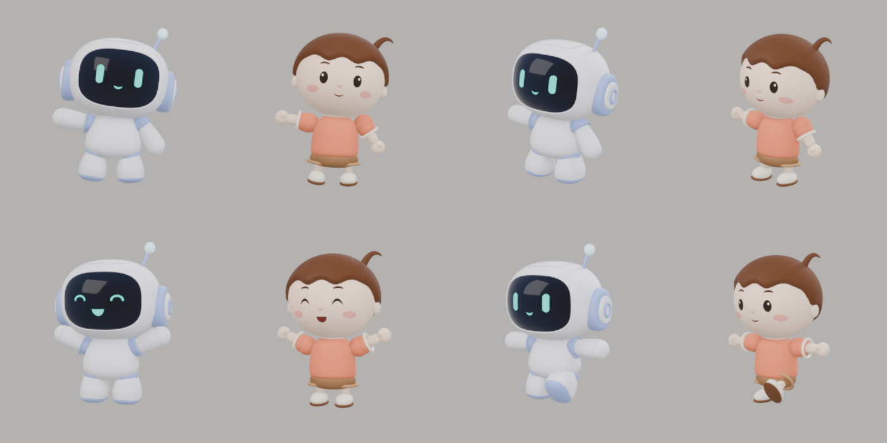
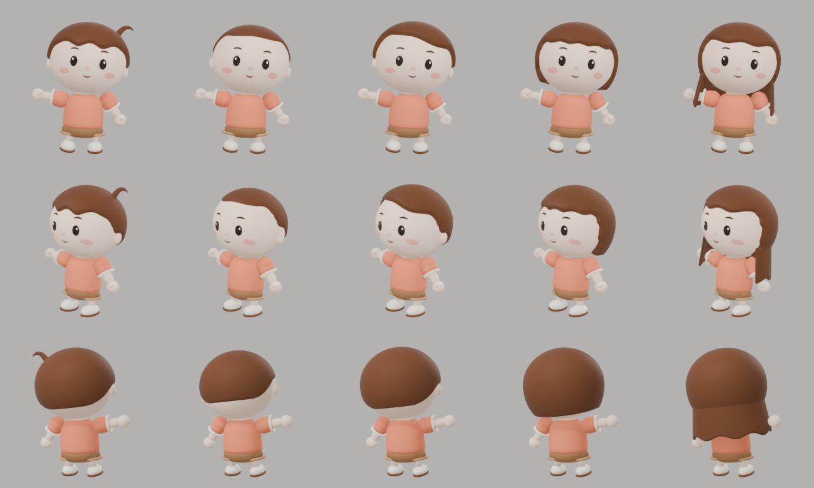

# 인간 모델 (남성 · 캐주얼)

로봇 모델과 **같은 뼈대**를 쓰는 동물의 숲 느낌의 인간 캐릭터입니다. 부위별로 인간과 로봇 파츠를 바꿔 보여주는 데 사용합니다.



## 파일

| 파일 | 설명 |
| --- | --- |
| `human_male.blend` | Blender 원본 (Blender 5.2.3 LTS) |
| `human_male.glb` | 웹용 (약 4.8MB, 텍스처 없음, 머리 모양 5종 포함) |
| `build_human.py` | 원본을 다시 만드는 스크립트 |
| `preview_robot_vs_human.png` | 로봇과 같은 포즈·표정으로 비교한 렌더 |
| `preview_hair_styles.png` | 머리 모양 5종 (정면·3/4·뒤) |

- 제작: 정규호 (@kokkumong), Claude Code 스크립트 생성 · 2026-11-10 · v0.2 (머리 모양 5종, 귀 분리)
- 관련 이슈: #17
- 원본 위치: 로봇 원본 [`assets/models/robot/robot.blend`](../robot/robot.blend)의 뼈대·애니메이션을 복사해서 만들었습니다.

## 머리 모양



| 오브젝트 | 머리 모양 | 함께 바꿀 것 |
| --- | --- | --- |
| `Hair_Short` (기본) | 짧은 앞머리 | `HairTuft`(삐친 머리) 보이기 |
| `Hair_Buzz` | 아주 짧은 머리 | `HairTuft` 숨기기 |
| `Hair_SidePart` | 이마 보이는 머리 | `HairTuft` 숨기기 |
| `Hair_Bob` | 단발 | `HairTuft`, `Ears`(귀) 숨기기 |
| `Hair_Long` | 긴 머리 | `HairTuft`, `Ears`(귀) 숨기기 |

- glb에는 다섯 가지가 **모두 보이는 상태**로 들어 있습니다. 쓰는 쪽에서 하나만 보이게 해야 합니다. 예시는 `experiments/human-robot-morph/`에 있습니다.
- Blender 파일은 `Hair_Short`만 보이게 저장했습니다. 숨긴 오브젝트를 내보내면 위치가 틀어지므로, 다시 내보낼 때는 머리 모양을 모두 보이게 한 뒤 내보냅니다(스크립트가 그렇게 합니다).
- 색은 재질 이름으로 바꿉니다: 피부 `HM_Skin`·`HM_SkinNose`, 머리 `HM_Hair`·`HM_Brow`, 옷 `HM_Shirt`

## 로봇과 같은 점

- 뼈 이름 14개와 관절 위치가 로봇 `robot.glb`와 같습니다. 관절 위치의 차이는 0입니다.
  `root, pelvis, spine, neck, head, antenna, shoulder_L/R, upper_arm_L/R, hand_L/R, leg_L/R`
- 애니메이션 18개(`robot_main`, `Pose_*`, `Face_Controls_Demo` 등)가 그대로 들어 있습니다.
- 표정 모프 이름이 같습니다: `Eye_L/R_FaceMorph`(Happy, Closed), `Mouth_FaceMorph`(OpenSmile)
- Blender에서는 로봇처럼 `head` 뼈의 속성(`eyes_happy`, `blink`, `mouth_open`)으로 표정을 바꿉니다.
- glb 안의 뼈 로컬 값은 로봇 glb와 다르게 보일 수 있습니다. 로봇 glb는 rig에 1.06배 크기가 걸린 채로 내보내졌고, 인간 glb는 그 크기가 뼈에 적용된 상태로 내보내졌기 때문입니다. 실제 위치는 같습니다.

## 파츠와 부위 대응

| 부위 (웹캠 실험 기준) | 뼈 | 인간 파츠 |
| --- | --- | --- |
| 머리 | head, antenna, neck | Head(얼굴·코), Ears, Hair_*, HairTuft(삐친 머리, antenna 뼈), Eye_L/R, Mouth, Brows, Cheeks, Neck |
| torso | spine, pelvis | Torso(티셔츠), Hips(반바지 허리) |
| leftArm / rightArm | upper_arm_L/R, hand_L/R | Arm_L/R(어깨·소매·팔), Hand_L/R |
| leftLeg / rightLeg | leg_L/R | Leg_L/R(반바지·다리·양말·신발) |

로봇처럼 파츠가 뼈에 통째로 붙어 움직입니다(스키닝 없음). 팔꿈치·무릎 뼈는 없습니다.

## 다시 만들기

로봇 원본을 연 상태에서 스크립트를 실행합니다.

```sh
Blender -b ../robot/robot.blend --python build_human.py -- human_male.blend human_male.glb
```

색·크기는 스크립트 위쪽의 `PALETTE`와 각 파츠 치수에서 바꿀 수 있습니다.

## 한계 / 다음 작업

- 기본 도형을 조합해 만든 모델이라 손으로 다듬은 디테일(머리카락 결, 옷 주름)은 없습니다.
- 여성·중성 몸(체형·옷)은 아직 없습니다. 머리 모양만 5종입니다.
- app 연동과 부위 교체 코드는 아직 만들지 않았습니다.
