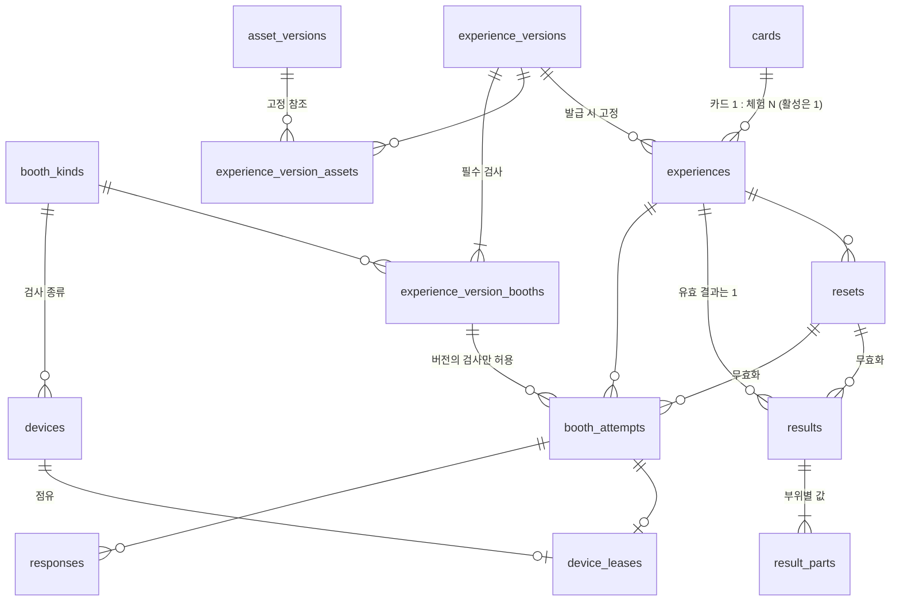
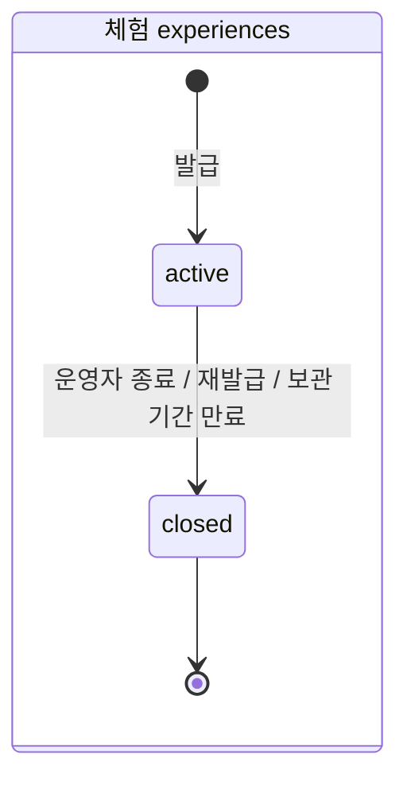
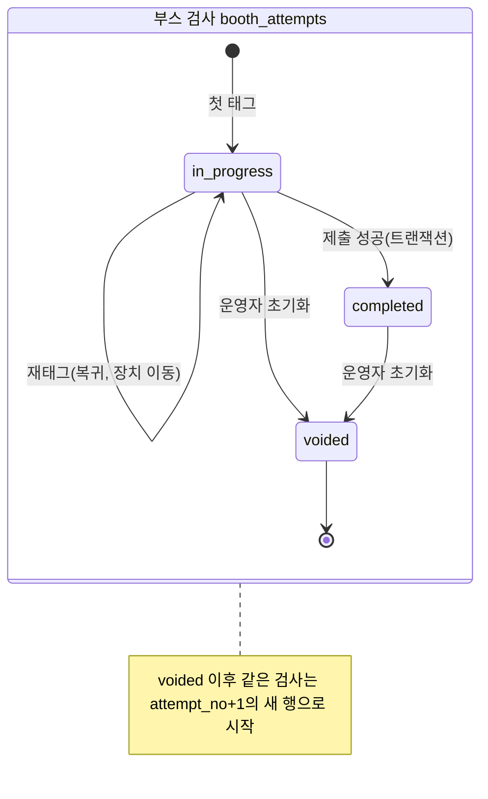
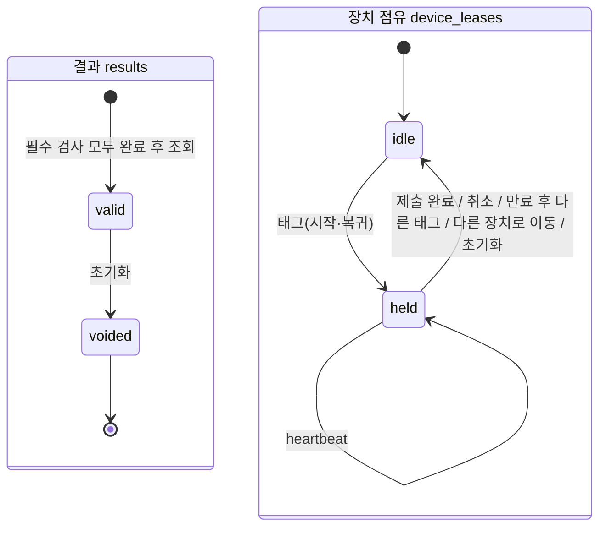

# NFC 사원증 체험 데이터·처리 설계 (초안 v0.11)

- 작성일: 2026-11-10
- 갱신: 2026-11-10 v0.1 — Q1 답변 반영(부스 = 라즈베리파이, 그 외 = 중앙 PC·개별 노트북)
- 갱신: 2026-11-10 v0.2 — Q2 답변 반영(검사 3개 = 앱의 `values` / `fit` / `person` 섹션), 부스 장비 = 라즈베리파이 5 8GB
- 갱신: 2026-11-10 v0.3 — Q4 답변 반영(사진은 발급 노트북에서만 사용), 부스 파이는 3D 프로그램이 아닌 웹 화면 위주(유력)
- 갱신: 2026-11-10 v0.4 — Q3 답변 반영(부위별 로봇화 0~100). 계산 규칙(4.3절)과 `result_parts` 테이블 추가
- 갱신: 2026-11-10 v0.5 — Q5 답변 반영(결과는 화면만. 증서 출력은 나중에 추가할 수 있게 확장 자리만 둠)
- 갱신: 2026-11-10 v0.6 — Q6 답변 반영(중앙 공간에서도 NFC로 개인 결과 확인). 읽기 전용 `central` 장치와 5.7절 흐름 추가
- 갱신: 2026-11-10 v0.7 — 결과 재확인 요구 확정(R13): 관객이 가진 카드를 전시장 중앙의 결과 보는 곳에 다시 태그해 최종 결과를 확인. 휴대폰·온라인 조회는 하지 않음
- 갱신: 2026-11-10 v0.8 — 역할 확정: 결과 장치 = 면접 합격·불합격 확인(2D), 중앙 공간 = 인간→로봇 실험 기반 3D 아바타(3.6절). 아바타 설정값 `experiences.avatar_json`, 오프라인 실행 조건, T6 추가
- 갱신: 2026-11-10 v0.9 — 중앙 아바타에 이목구비 특징 반영 기획 확인. 아바타 설정값에 얼굴 특징값 11개(-1~1, 0.05 단위) 추가, 당일 삭제 기본안(3.6절)
- 갱신: 2026-11-10 v0.10 — 특징값 삭제 시점 확정: 전시가 끝난 뒤 삭제(당일 삭제안 폐기). 관객 테스트 자료는 테스트 직후 삭제
- 갱신: 2026-11-10 v0.11 — Q8 확정(서버 불통 시 멈추고 재시도, 부스 임시 저장 없음). 서버 PC 고장 복구 절차(6.3절)와 S23 추가
- 관련 이슈: #19
- 상태: 초안. 팀 검토 전이므로 구현 기준으로 확정하지 않습니다. 결정이 바뀌면 이 문서의 해당 절과 아래 갱신 기록을 함께 고칩니다.
- 받은 요청: 섹션 5.1 끝부분(`booths` 설명)부터 9까지. 5.1의 테이블 후보 6개는 받지 못해, 2절의 해석과 3절의 제안으로 대신합니다.

---

## 0. 우선 확인할 질문 (설계 영향이 큰 순서)

답변이 없어도 아래 설계는 **기본 가정(★)**으로 진행할 수 있게 만들었습니다. 답변에 따라 바뀌는 부분은 본문에 `[Q번호]`로 표시합니다.

| # | 질문 | 선택지 | 기본 가정 ★ | 답에 따라 바뀌는 것 |
| --- | --- | --- | --- | --- |
| Q1 | 장비와 네트워크 구성 | **답변(11/10): 부스마다 라즈베리파이 1대. 그 외는 중앙 PC와 개별 노트북** | 확정. 노트북 역할 배분은 3.1절 가정 | 3.3절 라즈베리파이 운영 조건, T1·T5 |
| Q2 | "서로 다른 검사 3개"가 앱의 가치관 / 직무적합성 / 인성 섹션과 같은가 | **답변(11/10): 같다. 섹션 1개 = 부스 1개** | 확정. 직무 선택은 발급 노트북에서(P9) | `booth_kinds` = `values/fit/person`, `experiences.job_key`, 3.4절 앱 구성 |
| Q3 | 로봇 표현 방식 | **답변(11/10): 부위별 로봇화 0~100** | 확정. 부스별 부품 획득은 쓰지 않음 | 4.3절 계산 규칙, `result_parts` |
| Q4 | 촬영 위치와 이미지 공유 | **답변(11/10): 발급 노트북에서 찍고 그 장치에서만 사용** | 확정. 사진은 서버·DB·부스로 보내지 않음. 부스 배지는 기본 아바타 | `captures` 테이블 불필요, 파이에서 웹캠 인식 없음 |

Q1~Q8의 큰 방향은 모두 정해졌습니다(Q5: 결과는 화면만, 증서는 추후. Q6: 중앙 공간에서 카드로 3D 아바타 결과 확인. Q8: 서버 불통 시 멈추고 재시도). Q7은 이목구비 특징값 삭제 시점만 확정됐고, 이름 수집 여부와 응답·결과 보관 기간은 9절의 기본 가정입니다. 남은 결정은 11절에 모았습니다.

---

## 1. 기존 자료에서 확인한 사실

### 1.1 확인한 자료

`nfc/`, `기획서/`, `마일스톤/`, `프로토타입/`은 저장소 밖 팀 공유 폴더의 자료입니다. 저장소 안 경로는 저장소 루트 기준입니다.

| 자료 | 위치 | 이 설계에 주는 의미 |
| --- | --- | --- |
| NFC 기획 v1 | `nfc/nfc.md` | UID 기반 서버 조회, 입구 발급 부스 + 체험 부스 2·3·4번, USB 리더기, 로컬 LAN 서버. `users(uid PK)` + `booth_logs` 2테이블 예시 |
| NFC 기획 v2 | `nfc/nfc_exhibition_system_updated.md` | 입구 → 체험 부스 → **출구 결과 조형물**. 부스마다 **로봇 부품 획득**(HEAD_03 등). 중앙 서버 PC + 부스별 Mini PC + **Unity** 권장. 유선 LAN 우선 |
| 기획서 | `기획서/…기획서.docx (1).md` | TypeScript + React(Next.js), Three.js/R3F, Socket.IO, Node.js로 마스터 PC와 화면 3개 동기화 |
| 마일스톤 | `마일스톤/졸전 마일스톤.md` | G3 기술 검증 **2026-11-19**, G4 프로토타입 동결 **2026-12-20**, 개인정보 정책은 2027-01 확정. 8시간 연속 실행, 15초 내 자동 초기화, 5분 내 복구. 연결 끊김 시 "단일 컴퓨터 로컬 모드"를 대체안으로 명시 |
| 프로토타입 질문 | `프로토타입/졸전/questions.js` | 질문 3개 × 선택지 3개, 선택지마다 `robotScore`(최대 합 100) |
| 앱 (브랜치 `feature/15-interview-interactions`) | `app/index.html` | 단일 정적 HTML. 직무 6개 선택 → 촬영 → 섹션 3개(가치관 / 직무적합성 / 인성). 직무적합성은 **직무별 과제**라서 응답 형태가 다름. `answer`, `interviewend` 등 DOM 이벤트로 출력. 사진은 세션 메모리에서만 사용 |
| 웹캠 실험 (`codex/11-…`) | `experiments/webcam-robot/` | 부위 `torso / leftArm / rightArm / leftLeg / rightLeg`, 0~100, 좌우는 관객 기준. 사진·좌표는 서버로 보내지 않음 |
| 인간→로봇 실험 (`feature/17-…`) | `experiments/human-robot-morph/` | 부위 6개(**머리 포함**), 부위별 기준값(오른팔 15 → … → 머리 100), 합격선 75%. 사진에서 머리 모양·색과 **이목구비 특징값 11개**를 뽑아 아바타에 적용. 얼굴 생성기 `face.js`는 아직 커밋되지 않은 작업 중 파일 |
| 저장소 | 이 저장소 | DB·서버 코드 없음. dev 브랜치에는 문서만 있음(2026-11-10 기준) |

### 1.2 자료끼리 맞지 않는 부분

| 충돌 | 내용 | 처리 |
| --- | --- | --- |
| 실행 환경 | NFC 기획 v2는 Unity + Mini PC, 기획서·저장소는 웹(Three.js) | **부스는 웹으로 확정**(Q1). 라즈베리파이는 Unity 실행 대상으로 맞지 않음. 노트북 결과 장치만 Unity 여지가 있고 같은 API를 씀 |
| 로봇 표현 | NFC v2는 "부스당 부품 1개 획득", 실험은 "부위별 0~100 로봇화" | **결정(Q3):** 부위별 0~100. 웹캠 실험(부위별 값 → 불투명도)과 같은 방식. 인간→로봇 실험의 "전체 비율 + 부위별 기준값"은 결과 화면의 표현 방식으로만 남김(4.3절) |
| 부위 수·이름 | 웹캠 실험 5개(`leftArm` 등, 머리 없음), 인간→로봇 실험 6개(`armL`·`armR`·`legL`·`legR`·`torso`·`head`) | 저장은 요청서의 5개 이름. 3D 모델 부위와의 대응·좌우 방향·머리 처리는 콘텐츠의 `display`에서 정함(3.6절) |
| 인터넷 의존 | 인간→로봇 실험과 앱은 three.js·Draco·MediaPipe·폰트·인식 모델을 인터넷(CDN)에서 받음. 얼굴 분할 모델은 `latest` 주소라 버전도 고정되지 않음 | 전시용은 모든 파일을 로컬에 두고 `asset_versions`로 버전 고정(3.6절, T6) |
| 부스 구성 | 앱은 한 화면에서 3섹션을 순서대로 진행, NFC 기획은 부스를 자유롭게 방문 | **결정(Q2):** 섹션 1개 = 부스 1개. 앱을 장치 모드별로 나눔(3.4절). 직무 선택·인트로는 발급 노트북으로 이동 |
| 리더기 | NFC v1은 ACR122U를 "키보드 입력 방식"이라고 설명 | ACR122U는 보통 PC/SC 방식으로 알려져 있음. 실제 모델로 확인해야 함(6.4절, T1) |

### 1.3 전제로 삼은 확정 사항

- 관객은 NFC 카드 1장으로 식별합니다. 카드에는 개인정보를 쓰지 않고 UID만 읽습니다.
- 서로 다른 검사 3개가 있고, 관객은 순서 없이 방문할 수 있습니다.
- 필수 검사를 모두 마쳐야 최종 결과가 나옵니다.
- 기존 코드에는 DB가 연결돼 있지 않습니다.

---

## 2. 요구 사항 정리

### 2.1 확정

| ID | 요구 사항 |
| --- | --- |
| R1 | 카드 UID를 등록하고 체험(관객 1회 여정)과 연결한다 |
| R2 | 부스 첫 방문 시 검사 기록 생성. 진행 중 재태그는 기존 기록으로 복귀. 완료한 부스는 재검사 차단 |
| R3 | 응답은 검사 시작 때 정한 검사 기록 ID에 저장한다. 나중에 읽힌 카드가 응답의 주인을 바꾸지 않는다 |
| R4 | 응답 저장과 검사 완료는 한 트랜잭션으로 확정한다. 저장 실패를 완료로 표시하지 않는다 |
| R5 | 중복 태그·연타·재전송으로 기록이 두 번 생기지 않는다 |
| R6 | 결과는 필수 검사 **종류**가 모두 완료됐을 때만 계산. 미완료면 남은 부스를 돌려준다 |
| R7 | 결과는 반복 조회해도 한 번만 만들어지고 값이 같다. 입력과 규칙 버전을 추적할 수 있다 |
| R8 | 운영자는 부스 검사 하나 또는 체험 전체를 초기화한다. 시각·주체·사유를 남긴다 |
| R9 | 초기화와 제출·결과 조회가 겹쳐도 무효화된 기록이 되살아나지 않는다 |
| R10 | 체험 시작 시 콘텐츠 버전을 고정한다. 새 버전을 배포해도 진행 중인 체험은 이전 질문·규칙·에셋을 쓴다 |
| R11 | 공개된 콘텐츠·에셋 버전은 덮어쓰지 않는다 |
| R12 | 원본 제작 파일과 배포 에셋, 공용 에셋과 관객 이미지를 구분한다 |
| R13 | (11/10) 체험을 마친 관객이 카드를 전시장 중앙의 결과 보는 곳에 다시 태그하면, 언제든 같은 최종 결과(부위별 로봇화·총점·판정)를 다시 볼 수 있다. 휴대폰·온라인 조회는 범위 밖 |

### 2.2 제안 (이 문서의 설계 선택)

| ID | 제안 | 이유 |
| --- | --- | --- |
| P1 | 체험은 **카드 발급 시점**에 시작하고 콘텐츠 버전도 이때 고정 | 관객 1명의 모든 부스가 같은 버전을 쓰게 됨 |
| P2 | 부스 진행 중 응답은 서버에 임시 저장하지 않고, 완료 버튼에서 한 번에 제출 | 부스당 질문이 적어(1~2분) 다시 시작해도 부담이 작고, 반쯤 저장된 상태가 없어짐 |
| P3 | 장치 점유는 **임대(lease)** 방식. 일정 시간 신호가 없으면 자동 해제 | 관객이 말없이 떠나도 다음 관객이 쓸 수 있음 |
| P4 | 한 체험은 동시에 장치 1대만 점유. 같은 관객이 다른 장치에서 태그하면 이전 장치의 점유를 해제 | 관객이 말없이 다음 부스로 가도 이전 부스가 바로 비워짐 |
| P5 | 콘텐츠는 버전별 JSON 문서 1개 + 무결성용 연결 테이블 2개 | 4.1절 비교 참고 |
| P6 | 응답·검사·결과의 "유효" 여부는 검사 기록의 상태 하나로 판단 | 응답마다 유효 플래그를 두면 상태가 서로 어긋날 수 있음 |
| P7 | 부위별로 답변 효과를 모두 더한 뒤 마지막에 한 번만 0~100으로 자름(4.3절) | 방문 순서와 무관한 결과. 검토용 기본안이며 연출 규칙으로 확정한 것이 아님 |
| P8 | **(Q8 확정)** 서버 연결이 끊기면 부스는 "점검 중"을 표시하고 멈춘 뒤 재시도. 부스에 임시 저장하거나 나중에 동기화하지 않음 | 이중 완료 위험이 없고 구현이 단순함 |
| P9 | 직무는 발급 노트북에서 카드 발급 전에 고르고 `experiences.job_key`에 고정 | 직무적합성 부스가 어느 과제를 낼지 알아야 하고, 자유 방문 순서에서는 그보다 먼저 정해져 있어야 함 |
| P10 | 질문 제한 시간(현재 60초)이 지나 답이 없으면 `timeout` 응답으로 저장 | 현재 앱은 시간 초과 후 답 없이 다음으로 넘어갈 수 있음. 무응답 점수는 콘텐츠 규칙(`onTimeout`)이 정함 |

### 2.3 미결정

답변별 부위 효과 값, 머리 포함 여부, 총점 계산 방식, 결과 화면의 부위 표현 방식, 노트북 대수와 역할 배분, 디자인 과제를 파이에서 3D로 둘지 2D로 바꿀지, 무응답(시간 초과) 점수, 증서 출력 추가 여부(마일스톤 G5 범위 동결 2027-01-31까지), 중앙 공간 장비와 관람 순서(결과 장치보다 먼저 갈 수 있는지), 이름 수집 여부, 보관 기간, 부스당 질문 수와 응답 형식, 점수·판정 규칙.

---

## 3. 전체 구조

### 3.1 구성 요소와 역할

| 구성 요소 | 역할 | 갖지 않는 책임 |
| --- | --- | --- |
| NFC 리더기 | 카드 UID 읽기 | 관객 판단·저장 |
| 리더 연결 프로그램 (각 장치, 리더기 방식에 따라 필요) | UID를 읽어 `device_id`와 함께 서버에 전송 | 화면 표시 |
| 발급 장치 — **노트북** | 카드 등록, 체험 생성, (선택) 이름 입력 | 검사 진행 |
| 부스 앱 — **라즈베리파이** + Chromium 키오스크 | 고정된 버전의 질문 표시, 응답 수집, 완료 제출, 즉시 연출 | 결과 확정 계산, 영구 저장 |
| 결과 장치 — 노트북 또는 파이 (2D) | **면접 합격·불합격 확인.** 처음 태그 때 결과를 계산·확정하고 판정을 보여줌. 미완료면 남은 부스 안내 | 계산 규칙 보유, 3D 연출 |
| 중앙 공간 장치 — **노트북 권장** (3D) | 카드 태그 시 확정된 부위별 로봇화를 **관객 아바타(동숲풍 인간 모델) 3D**로 보여줌. 다시 태그하면 언제든 재확인(R13). 읽기 전용 | 결과 계산·생성, 응답 수집 |
| 운영자 화면 — 중앙 PC 또는 노트북 브라우저 | 장치 상태, 체험 조회, 초기화, 카드 해제 | — |
| 중앙 서버 — **중앙 PC** | 모든 상태 변경의 유일한 결정권자. 점유·트랜잭션·결과 계산. 기준 시계 | 관객용 화면 렌더링 |
| DB | 체험·검사·응답·결과·버전·감사 기록 | 파일 원본 |
| 에셋 저장소 (서버 로컬 폴더) | 배포 에셋 파일(불변) | 제작 원본, 관객 사진(Q4: 저장하지 않음) |

### 3.2 통신 경로

```text
                 ┌──────────────────────── 중앙 서버 (Node.js + TypeScript) ───────────────────────┐
                 │  HTTP API (/api/*)    WebSocket (장치별 상태 알림)    정적 파일 (/assets/*)     │
                 │                │                                                                  │
                 │          SQLite (WAL)                storage/assets                              │
                 └────────▲──────────────▲───────────────────▲──────────────────▲────────────────────┘
                          │ 유선 LAN     │                   │                  │
     ┌────────────────────┴───┐  ┌───────┴──────────────┐  ┌───┴──────────┐  ┌────┴─────────┐
     │ 발급 장치 (노트북)      │  │ 부스 × 3 (라즈베리파이)│  │ 결과 장치    │  │ 운영자 화면  │
     │ 리더기 → 리더 프로그램  │  │ 리더기 → 리더 서비스   │  │ (노트북)     │  │ (중앙 PC 등) │
     │ 브라우저                │  │ Chromium 키오스크      │  │ 리더기 → …   │  │ 브라우저     │
     └─────────────────────────┘  └───────────────────────┘  └──────────────┘  └──────────────┘
```

1. 리더 프로그램이 `POST /api/tags {device_id, uid}`를 보냅니다. 리더기 → 서버로 바로 가므로 브라우저 포커스와 무관합니다.
2. 서버가 판단(발급 / 검사 시작·복귀 / 차단 / 결과)하고, 해당 장치의 브라우저에 WebSocket으로 알립니다.
3. 부스 브라우저는 서버가 준 `attempt_id`와 `lease_token`만 들고 진행합니다. 이후 제출은 이 두 값을 기준으로 하며, 그 사이 읽힌 다른 카드는 영향을 주지 않습니다.
4. 키보드 입력 방식 리더기를 쓰면 1번을 브라우저가 대신합니다(6.4절).
5. 중앙 공간 장치도 같은 방식(리더기 → 서버 → WebSocket 알림)으로 연결합니다. 그림에는 생략했습니다.

중앙 PC에는 서버만 두는 것을 기본으로 합니다. 관객용 화면을 함께 띄우면 그 화면의 문제(GPU 멈춤, 실수로 창 닫기)가 서버까지 멈출 수 있습니다. 노트북 대수가 부족하면 운영자 화면 정도만 중앙 PC에서 엽니다.

### 3.3 라즈베리파이 5(8GB) 부스 운영 조건

부스 라즈베리파이는 **저장하지 않는 단말**로 둡니다. 체험 상태는 모두 중앙 서버에 있으므로, 파이를 교체하거나 다시 켜도 데이터가 사라지지 않습니다.

| 항목 | 위험 | 설계 대응 | 확인 단계 |
| --- | --- | --- | --- |
| 시계 | 파이 5는 RTC가 있지만 배터리를 따로 달지 않으면 전원이 꺼질 때 시각을 잃고, 인터넷이 없으면 맞출 수 없음 | **모든 시각은 서버가 기록.** 점유 만료·응답 시각·결과 시각을 장치 시계로 판단하지 않음. `responses.answered_at`은 참고용. (선택) 중앙 PC를 LAN 시간 서버로 사용 | T3 |
| 전원 | 5V 5A를 못 주는 전원이면 파이 5가 USB 출력을 제한함 | 공식 27W USB-C 전원 사용. 리더기는 파이 USB에 직접 연결 | T1·T5 |
| 발열 | 3D를 오래 돌리면 온도가 올라 성능이 떨어짐(스로틀링) | 공식 Active Cooler 또는 방열 케이스. 부스 구조물 안 통풍 확보. `vcgencmd get_throttled`로 확인 | T5 |
| 전원 차단·SD 카드 | 갑자기 전원이 끊기면 SD 카드 파일이 깨질 수 있음 | 읽기 전용 파일 시스템(오버레이) 사용, 로그는 서버로 전송. 같은 내용의 예비 SD 카드 준비. (선택) M.2 HAT + NVMe SSD | T5 |
| 화면 성능 | 부스는 웹 화면(2D 위주)으로 갈 가능성이 높음. 현재 앱에서 3D를 쓰는 것은 디자인 직무의 색 맞추기 과제(`robot.glb` 약 1.1MB)뿐 | 부스는 2D 웹 기준으로 측정. 디자인 과제는 (1) 가벼운 3D 유지 (2) 2D 이미지 버전으로 교체 중 T5 측정 후 결정. 인간→로봇 3D 연출은 노트북 결과 장치에서 | T5 |
| 화면 연결 | 파이 5 출력 단자는 micro-HDMI | micro-HDMI → HDMI 케이블·어댑터를 부스 수 + 예비만큼 준비 | T5 |
| 웹캠 인식 | — | **해당 없음(Q4).** 촬영·인식은 발급 노트북에서만 하고 파이에는 카메라를 달지 않음 | — |
| 리더기 | 리눅스(ARM) 드라이버 | PC/SC 리더기는 `pcscd` 서비스로 읽음. 키보드 입력 방식은 드라이버 없이 동작 | T1 |
| 부팅·복구 | 운영자가 매번 설정할 수 없음 | 전원 켜면 리더 서비스와 Chromium 키오스크가 자동 실행(systemd). 장치 ID는 파이별 설정 파일 1개 | T5 |
| 에셋 | 메모리·저장 공간이 작고 SD 카드는 느림 | 자기 부스 검사 종류에 필요한 에셋만 미리 받음. 내용 해시 경로라 브라우저 캐시를 그대로 사용 | T4 |
| 네트워크 | Wi-Fi는 전시장에서 끊기기 쉬움 | 파이와 중앙 PC는 유선 LAN + 스위치. 고정 IP 또는 공유기 DHCP 예약 | T3 |
| 화면 보호·절전 | 화면이 꺼지거나 커서가 보임 | 절전·화면 보호기 끄기, 커서 숨기기 | T5 |

노트북도 절전·자동 업데이트·잠금 화면을 끄고, 중앙 PC는 전원 옵션에서 절전을 해제합니다. 노트북 배터리는 짧은 정전 대비 역할도 하지만 중앙 PC는 UPS(무정전 전원 장치) 사용을 검토합니다.

### 3.4 앱 구성 (Q2 반영)

현재 앱(`app/index.html`, 브랜치 `feature/15-interview-interactions`)은 한 화면에서 인트로 → 직무 선택 → 촬영 → 섹션 3개를 순서대로 진행합니다. 이를 **하나의 웹 앱 + 장치 모드**로 나눕니다. 장치 모드는 장치 설정의 `role`과 `booth_kind_id`로 정해집니다.

| 장치 | 모드 | 현재 앱에서 가져올 화면 | 서버 호출 |
| --- | --- | --- | --- |
| 발급 노트북 | `issue` | 로고 인트로, 홈, 면접대기실, 직무 선택, 면접 진행 안내, 촬영 → "사원증을 태그하세요" | 태그 → 체험 생성(`job_key` 포함). 사진은 보내지 않음 |
| 부스 파이 × 3 | `booth:values` / `booth:fit` / `booth:person` | 대기 화면(새로 만듦) → 섹션 안내 → 질문 또는 직무별 과제 → 완료 안내 + 남은 부스 | 태그 → 시작·복귀, heartbeat, 제출 |
| 결과 장치 | `result` | 면접 완료 화면을 합격·불합격 발표 화면으로 확장(2D) | 태그 → 결과 조회(없으면 계산) |
| 중앙 공간 | `central` | `experiments/human-robot-morph/`의 3D 장면 + 대기 화면 | 태그 → 확정 결과 + 아바타 설정값 읽기만(5.7절) |

앱 코드에서 바꿀 점:

- `SECTIONS`, `QUESTIONS`, `JOBS`, `ARCADE`, `DT_ROUNDS`의 문구·선택지·과제 정의를 콘텐츠 JSON(4.2절)으로 옮기고, 부스는 서버가 준 고정 버전에서 읽습니다.
- 선택은 지금처럼 순번(0, 1, 2)이 아니라 **선택지 키**로 저장합니다. 문구 순서를 바꿔도 이전 응답의 뜻이 바뀌지 않습니다.
- 섹션 끝의 `answer` 이벤트가 곧 그 부스의 제출입니다. `interviewend`(세 섹션 모두 끝)는 부스에서 쓰지 않고, 결과 장치의 결과 조회가 대신합니다.
- 진행 표시(`fill: 26% / 63% / 100%`)는 고정 순서를 전제합니다. 자유 방문 순서에 맞게 "완료한 검사 / 남은 검사" 표시로 바꿉니다.
- 부스 모드에서는 DEV 메뉴를 숨기고, 제출 완료·점유 해제·초기화 알림 때 대기 화면으로 돌아갑니다.

직무적합성 부스는 체험의 `job_key`에 따라 내용이 다릅니다.

| job_key | 직무적합성 부스 내용 | 응답 형태 | 파이 부담 |
| --- | --- | --- | --- |
| `design` | 로봇 색 맞추기 3건 | 과제 결과(`rounds`) | 현재 **3D(Three.js)**. 파이를 웹(2D) 위주로 가면 2D 버전 필요 — T5에서 결정 |
| `dev` | 명령 쌓기 3건 | 과제 결과 | 2D |
| `marketing` | 트렌드 선택 6건 | 과제 결과 | 2D |
| `hr` | 서류 심사 3건 | 과제 결과 | 2D |
| `biz`, `etc` | 직무적합성 질문 | 단일 선택 | 2D |

### 3.5 관객 사진 처리 (Q4 반영)

| 규칙 | 내용 |
| --- | --- |
| 촬영 위치 | 발급 노트북 웹캠 |
| 사용 범위 | 발급 노트북 화면(지원자 배지 연출 등)에서만 |
| 보관 | 브라우저 메모리에만. 서버 전송, 디스크·`localStorage` 저장, DB 기록 없음 |
| 삭제 시점 | 카드 발급이 끝나 대기 화면으로 돌아갈 때, 처음으로 버튼, 무조작 자동 초기화(마일스톤 15초 기준) 중 가장 이른 때 |
| 다른 장치 표시 | 부스 배지·결과 화면은 기본 아바타 |
| 중앙 아바타용 값 | 사진은 보내지 않고, 발급 노트북에서 사진을 분석해 얻은 **아바타 설정값**(머리 모양·색·이목구비 특징값)만 `experiences.avatar_json`으로 서버에 보냄(3.6절). 특징값은 **전시가 끝난 뒤 삭제**(11/10 확정) |

이 규칙은 기존 문서(촬영 이미지는 세션 안에서만 처리)와 같습니다.

### 3.6 중앙 공간 3D 아바타 (인간→로봇 실험 연결)

| 장치 | 보여주는 것 | 화면·장비 |
| --- | --- | --- |
| 결과 장치 | 면접 합격·불합격(`verdict`). 필요하면 총점 | 2D. 노트북이나 파이 모두 가능 |
| 중앙 공간 | 관객 아바타가 부위별 로봇화 값만큼 로봇으로 바뀐 3D 모습 | `experiments/human-robot-morph/` 기반 Three.js. 노트북 권장(T6에서 확인) |

중앙 공간 화면의 입력은 네 가지이고, 모두 서버에서 받습니다: `result_parts`(부위별 값), `experiences.avatar_json`(아바타 설정값), 체험의 고정 콘텐츠 버전의 `display` 규칙, 그 버전의 에셋(인간·로봇 모델, 애니메이션).

#### 부위 대응과 좌우

저장 이름(요청서)과 3D 모델 부위(실험)가 다르므로 콘텐츠 `display.partMap`에서 연결합니다.

| 저장 부위 | 3D 모델 부위 (실험 `PARTS`) | 관련 뼈 |
| --- | --- | --- |
| `torso` | `torso` | spine, pelvis, root |
| `leftArm` / `rightArm` | `armR` / `armL` 또는 `armL` / `armR` (아래) | shoulder·upper_arm·hand |
| `leftLeg` / `rightLeg` | `legR` / `legL` 또는 `legL` / `legR` (아래) | leg |
| (점수 부위 아님) | `head` | head, neck, antenna |

- 모델의 `_L` 뼈는 모델 자신의 왼쪽입니다. 아바타를 **거울 속 나**로 보여주면 관객의 왼팔은 화면 왼쪽, 즉 모델의 오른팔(`armR`)에 대응합니다. **나를 마주 보는 사람**으로 보여주면 `leftArm → armL`입니다.
- 기본값은 거울 방향입니다. 웹캠 실험과 발급 노트북 촬영 화면이 거울 방향이라 관객이 같은 기준으로 읽을 수 있습니다. S18에서 실제 관객 기준으로 확인합니다.
- 머리: 실험은 "머리(자아)는 마지막에 바뀜"이었습니다. 기본값은 `display.head = "allMax"`로, 다섯 부위가 모두 100일 때만 머리도 로봇으로 표시합니다. 저장 값에는 머리가 없고 화면 규칙만 있습니다. 다른 안: 머리는 항상 인간, 또는 머리를 점수 부위로 추가(미정).
- 표현 방식은 `display.mode`로 고릅니다. `blend`는 값만큼 인간·로봇을 섞고(웹캠 실험), `threshold`는 기준값 이상이면 전환합니다(인간→로봇 실험의 0.55초 전환 연출).

#### 아바타 설정값

발급 노트북에서 촬영 직후 실험의 `analyzePhoto`를 실행하고, 결과 중 아래 값만 체험에 저장합니다. 중앙 공간은 이 값으로 실험과 같은 아바타를 다시 그립니다.

| 보내는 값 | 내용 | 검증 |
| --- | --- | --- |
| `hairStyle` | 머리 모양 5종(`Short`, `Buzz`, `SidePart`, `Bob`, `Long`) 중 하나 | 버전의 `avatar.hairStyles` 안 |
| `skin` | 피부 팔레트 7색 중 하나 | 버전의 `avatar.skinPalette` 안 |
| `hair` | 머리 팔레트 9색 중 하나 | 버전의 `avatar.hairPalette` 안 |
| `clothes` | 보정한 옷 색 1개(#RRGGBB) | 형식 검사 |
| `face` | 이목구비 특징값 11개: `eyeSize`, `eyeOpen`, `eyeTilt`, `eyeGap`, `browThick`, `browTilt`, `browArch`, `noseSize`, `mouthSize`, `lipThick`, `faceLong`. 각각 -1~1 | 키가 버전의 `avatar.faceTraits`와 같고, 값이 -1~1이며 0.05 단위 |
| `source` | `photo` / `manual` / `default` | — |

| 보내지 않는 값 | 이유 |
| --- | --- |
| 사진, 분할 마스크, 얼굴 랜드마크 | Q4(사진은 발급 노트북에서만) |
| 실제 측정값(`features.raw`) | 얼굴 길이 비율 같은 원래 측정값은 아바타에 필요 없음. 보내는 것은 평균에서 얼마나 벗어났는지를 -1~1로 줄인 `traits`뿐 |
| 분석 경고 문구(`warnings`) | 발급 화면에서만 씀 |

- 분석에 실패하면(얼굴 미검출 등) 기본값으로 두고, 발급 화면에서 직원이나 관객이 직접 고릅니다(실험의 수동 수정 기능).
- **0.05 단위인 이유:** `face.js`가 그릴 때 이미 0.05 단위로 반올림합니다. 같은 단위로 보내면 중앙 화면이 실험과 똑같이 나오고, 그보다 정밀한 값은 남기지 않습니다. 디자인 확인 후 더 거칠게(예: 0.25 단위) 줄여도 차이가 작다면 그쪽이 개인정보 면에서 낫습니다(T6에서 비교).
- 과장 정도(실험의 `exag` 슬라이더)는 관객별 값이 아니라 콘텐츠 `display.faceExaggerate`로 둡니다.
- 촬영 안내에 "사진은 저장하지 않습니다. 사진에서 머리 모양·색·이목구비 특징만 뽑아 전시 기간 동안 아바타를 만드는 데 쓰고, 전시가 끝나면 지웁니다"를 표시하고, 원하지 않으면 기본 아바타로 진행할 수 있게 합니다(`source = default`).

**개인정보 취급(기본안):**

- 얼굴 특징값은 사진에서 나온 정보라 색·머리 모양보다 조심해서 다룹니다. 이 값으로 사진을 되살릴 수는 없고, 이름과 함께 저장하거나 표시하지 않으며, 사람을 알아보는 데 쓰지 않습니다.
- **전시가 끝난 뒤**(마지막 운영일 종료 후, 철수 전) 모든 체험의 `avatar_json`을 지우고 `avatar_purged_at`을 기록합니다(11/10 확정). 전시 기간에는 어느 날 다시 와도 같은 카드로 자기 아바타를 볼 수 있습니다. 결과·응답 삭제(Q7)와 같은 날 함께 처리하는 것을 기본으로 합니다.
- 12월 관객 테스트 등 **전시 전 테스트**에서 실제 사람 사진으로 만든 특징값은 그 테스트가 끝나면 바로 지웁니다. 전시까지 보관하지 않습니다.
- DB 백업 파일에도 남지 않도록, 삭제 후 백업을 새로 만들고 이전 백업은 지웁니다.
- 학교나 전시 측 개인정보 안내 기준이 있으면 그에 맞춥니다. 이 문서는 법률 검토가 아닙니다.

#### 전시장 오프라인 실행

- 실험은 three.js, Draco 디코더, MediaPipe(WASM), 인식 모델 2개, Pretendard 폰트를 인터넷에서 받습니다. 전시용은 모두 중앙 서버의 `/assets`에서 받도록 바꾸고 `asset_versions`에 등록합니다.
- 얼굴 분할 모델 주소가 `…/latest/…`라 같은 주소에서 다른 파일이 내려올 수 있습니다. 특정 파일을 받아 해시와 함께 버전으로 고정합니다(R10, R11).
- 발급 노트북의 사진 분석도 인터넷 없이 돌아가야 합니다. T6에서 인터넷을 끊고 확인합니다.

---

## 4. 데이터 설계

### 4.1 콘텐츠 관리: 정규화 vs 버전별 JSON 문서

| 기준 | 질문·선택지·가중치를 테이블로 정규화 | 버전별 JSON 문서 1개 |
| --- | --- | --- |
| 직무별 과제처럼 형태가 다른 응답 | 과제마다 테이블·컬럼이 늘어남 | 과제 유형별 JSON 형식으로 표현 |
| 기획자가 문구·점수 수정 | 관리 화면이나 SQL이 필요 | 파일 하나를 고치고 검증 스크립트 실행 |
| 버전 고정 | 모든 하위 테이블에 버전 키, 복사 비용 큼 | 행 1개를 불변으로 두면 끝 |
| 응답 검증 | FK로 선택지 존재 보장 | 제출 시 서버가 JSON 기준으로 검증 |
| 질문별 통계 SQL | 쉬움 | SQLite `json_extract`로 가능하지만 번거로움 |
| 에셋 참조 무결성 | FK로 보장 | JSON만으로는 보장 못 함 → 연결 테이블 필요 |

**권장: 혼합 방식.** 질문·선택지·가중치·판정 규칙은 버전별 JSON 문서로 두고, DB가 보장해야 하는 두 가지만 테이블로 뽑습니다.

- `experience_version_booths`: 필수 검사 목록. 결과 계산 시 SQL로 "남은 부스"를 구하고, 검사 기록이 해당 버전의 검사인지 FK로 막습니다.
- `experience_version_assets`: 버전이 참조하는 에셋 버전. 사용 중인 에셋 버전을 지울 수 없게 합니다.

공개(publish) 시 JSON에서 이 두 테이블을 자동으로 채우고, 내용이 다르면 공개를 거부합니다.

### 4.2 콘텐츠 JSON 예시

```jsonc
{
  "schema": 1,
  "version": "2026.11-a",
  "parts": ["torso", "leftArm", "rightArm", "leftLeg", "rightLeg"],   // [Q3] 머리 포함 여부
  "jobs": ["dev", "design", "hr", "marketing", "biz", "etc"],
  "booths": [
    {
      "kind": "values",
      "questions": [
        {
          "key": "values.q1",
          "type": "single_choice",
          "prompt": "업무 절차가 불합리하다고 느껴질 때…",
          "timeLimitSec": 60,
          "choices": [
            { "key": "a", "label": "절차를 그대로 따른다", "effects": { "torso": 35, "rightArm": 20 } },
            { "key": "b", "label": "따르되 개선 의견을 기록한다", "effects": { "torso": 20 } },
            { "key": "c", "label": "다른 방식을 제안한다", "effects": { "torso": 8 } }
          ],
          "onTimeout": { "effects": { "torso": 20 } }        // P10. 값은 미정
        }
      ],
      "assets": { "intro_video": "asset:booth-values-intro@3" }
    },
    {
      "kind": "fit",
      "questions": [
        { "key": "fit.design", "type": "task", "task": "design-color", "when": { "job": "design" },
          "rounds": [ /* 목표 색·제한 시간 */ ],
          "scoring": { "by": "approvedCount", "table": { "0": { "leftArm": 5 }, "3": { "leftArm": 40, "rightArm": 40 } } } },
        { "key": "fit.dev", "type": "task", "task": "command-stack", "when": { "job": "dev" } },
        { "key": "fit.common", "type": "single_choice", "when": { "job": ["biz", "etc"] }, "choices": [ /* … */ ] }
      ]
    },
    { "kind": "person", "questions": [ /* … */ ] }
  ],
  "rules": {
    "engine": "part-sum-v1",            // 서버 코드의 계산 함수 이름·버전
    "base": { "torso": 0, "leftArm": 0, "rightArm": 0, "leftLeg": 0, "rightLeg": 0 },
    "total": { "method": "mean" },      // 또는 { "method": "weighted", "weights": { … } }
    "passLine": 75                      // 기획서 기준
  },
  "display": {                          // 중앙 공간 3D 표현(3.6절). 저장되는 결과값에는 영향 없음
    "mode": "blend",                    // blend: 값만큼 섞기 / threshold: 기준값 이상이면 전환
    "thresholds": { "rightArm": 15, "leftArm": 30, "rightLeg": 45, "leftLeg": 60, "torso": 75 },
    "orientation": "mirror",            // mirror: 거울 속 나 / facing: 마주 보는 사람
    "partMap": { "torso": "torso", "leftArm": "armR", "rightArm": "armL", "leftLeg": "legR", "rightLeg": "legL" },
    "head": "allMax",                   // 다섯 부위가 모두 100일 때만 머리도 로봇
    "faceExaggerate": 1.0               // 이목구비 특징 과장 정도(실험의 exag)
  },
  "avatar": {
    "hairStyles": ["Short", "Buzz", "SidePart", "Bob", "Long"],
    "skinPalette": ["#FFE7D6", "#FCDCC8", "#F3C9A9", "#E2B08A", "#C68E66", "#9C6A47", "#6E4A33"],
    "hairPalette": ["#2A2220", "#4A2E20", "#6B3E26", "#9A6A3F", "#D8B26A", "#9C3F2A", "#A8A39E", "#E58FA8", "#4E6FB8"],
    "faceTraits": ["eyeSize", "eyeOpen", "eyeTilt", "eyeGap", "browThick", "browTilt", "browArch",
                   "noseSize", "mouthSize", "lipThick", "faceLong"],
    "faceStep": 0.05
  },
  "assets": {
    "robot_model": "asset:robot-model@4", "human_model": "asset:human-model@2",
    "seg_model": "asset:mediapipe-selfie-multiclass@1", "face_model": "asset:mediapipe-face-landmarker@1"
  }
}
```

- 질문·선택지 키(`values.q1`, `a`)는 버전 안에서 고유합니다. 응답은 이 키로 저장합니다.
- `when.job`이 있는 질문은 체험의 `job_key`가 맞을 때만 필수입니다. 공개 검증에서 직무마다 `fit` 필수 질문이 1개 이상인지 확인합니다.
- 에셋은 반드시 `asset:<asset_key>@<version>`처럼 **정확한 버전**으로 참조합니다. "최신" 참조는 공개 검증에서 거부합니다.
- 계산 규칙의 값은 JSON에, 계산 함수는 서버 코드에 둡니다. 결과에 `rules.engine`과 코드 버전을 함께 기록합니다.

### 4.3 부위별 로봇화 계산 규칙 (Q3 반영, 기본안 `part-sum-v1`)

1. **효과 모으기:** 완료된 검사 기록의 응답마다 효과를 찾습니다. 선택지는 `choices[].effects`, 시간 초과는 `onTimeout.effects`, 직무 과제는 `scoring` 표에서 과제 결과에 맞는 효과를 씁니다. 효과는 `{부위: 정수}`이며 음수도 허용합니다(인간 쪽으로 되돌리는 선택).
2. **부위별 합산:** `raw[부위] = base[부위] + 모든 효과의 합`.
3. **마지막에 한 번만 자르기:** `value[부위] = min(100, max(0, raw[부위]))`. 중간 단계마다 자르면 순서에 따라 결과가 달라지므로, 자르는 것은 끝에서 한 번입니다.
4. **총점:** 기본은 부위 값의 평균(정수 반올림). 가중 평균을 쓰려면 `rules.total`에 가중치를 둡니다.
5. **판정:** `총점 ≥ passLine`이면 합격(`pass`), 아니면 `fail`.

이 규칙은 응답 집합만 보고 방문 순서와 제출 시각은 보지 않으므로, 같은 응답이면 언제나 같은 결과가 나옵니다(R7, P7). 값은 모두 정수라 소수점 차이가 생기지 않습니다.

공개 검증에서 확인할 것:

- 모든 `effects`의 부위 키가 `parts` 목록에 있음
- 직무 6개 각각에 대해, 모든 답을 가장 로봇 쪽으로 골랐을 때와 가장 인간 쪽으로 골랐을 때의 부위 값·총점 범위를 출력. 합격선 75에 도달할 수 있는 직무와 없는 직무가 생기지 않는지 기획자가 확인합니다(인간→로봇 실험의 "답 2개 × 질문 3개로는 0·33·67·100%만 나온다" 문제를 공개 전에 발견하기 위함)

좌우는 관객 기준입니다. `leftArm`은 관객의 왼팔입니다. 3D 모델의 어느 쪽 팔로 그릴지는 `display.orientation`·`partMap`이 정하고(3.6절), 저장 값은 바꾸지 않습니다.

부스의 즉시 연출: 부스 시작 응답에 이미 완료한 검사 기준의 **중간 부위 값**(같은 계산 함수로 계산, 저장하지 않음)을 함께 줍니다. 부스는 여기에 현재 답의 효과를 더해 2D 화면에서 바로 보여줄 수 있습니다. 확정 값은 결과 장치에서 서버가 계산한 값뿐입니다.

기존 질문 데이터(`questions.js`의 `robotScore`)는 전체 점수 1개라 부위 정보가 없습니다. 선택지마다 어느 부위에 얼마를 줄지 기획에서 새로 정해야 합니다.

### 4.4 ERD



MVP 필수 테이블은 11개(`booth_kinds`, `devices`, `asset_versions`, `experience_versions`, `experience_version_booths`, `experience_version_assets`, `cards`, `experiences`, `booth_attempts`, `responses`, `results`)에 `device_leases`, `resets`, `result_parts`를 더한 14개입니다. `event_log`는 권장입니다. Q4 답변에 따라 `captures`는 만들지 않습니다. 연결 테이블 2개는 작고 자동으로 채워지므로 관리 부담이 거의 없습니다.

### 4.5 데이터 사전

표기: **PK** 기본 키, **FK** 외래 키, **필수** NOT NULL, **UQ** 고유, **CK** 검사 제약. 시각은 ISO-8601 UTC 문자열, ID는 서버가 만드는 ULID 문자열입니다.

#### 기준 정보

**`booth_kinds`** — 논리적 검사 종류

| 컬럼 | 형식 | 제약 | 설명 |
| --- | --- | --- | --- |
| id | TEXT | PK | `values`, `fit`, `person` (앱 섹션 키와 같음) |
| name | TEXT | 필수 | 표시 이름 |
| sort_order | INTEGER | 필수 | 안내 순서(방문 순서 강제 아님) |

**`devices`** — 물리 장치

| 컬럼 | 형식 | 제약 | 설명 |
| --- | --- | --- | --- |
| id | TEXT | PK | `booth-values-1`처럼 사람이 읽을 수 있는 값. 장치 설정 파일에 기록 |
| role | TEXT | 필수, CK `issue/booth/result/central/admin` | 장치 역할. `central`은 결과를 읽기만 함 |
| booth_kind_id | TEXT | FK, CK `role='booth'`일 때만 필수 | 같은 검사를 여러 대가 제공 가능 |
| label | TEXT | 필수 | 현장 라벨 |
| enabled | INTEGER | 필수, 기본 1 | 0이면 태그 거부 |
| last_seen_at | TEXT | 선택 | 마지막 신호 |

#### 콘텐츠·에셋

**`asset_versions`** — 배포 에셋 파일 버전(불변)

| 컬럼 | 형식 | 제약 | 설명 |
| --- | --- | --- | --- |
| id | INTEGER | PK | |
| asset_key | TEXT | 필수 | `robot-model` |
| version | INTEGER | 필수, UQ(asset_key, version) | 1부터 증가 |
| kind | TEXT | 필수, CK `model/image/video/audio/font/data` | |
| storage_key | TEXT | 필수, UQ | `assets/ab/ab12…ef.glb` (내용 해시 경로) |
| mime_type | TEXT | 필수 | |
| byte_size | INTEGER | 필수, CK > 0 | |
| sha256 | TEXT | 필수 | 공개 검증 시 실제 파일과 비교 |
| source_ref | TEXT | 선택 | 원본 위치(공유 드라이브·LFS 경로, 커밋). 원본 파일은 서버에 두지 않음 |
| author / origin / license | TEXT | 선택 | 제작자·출처·라이선스 |
| meta_json | TEXT | 선택, CK `json_valid` | 해상도, 폴리곤 수 등 |
| created_at | TEXT | 필수 | |

갱신 금지 트리거: `storage_key`, `sha256`, `byte_size` 변경을 거부합니다. 파일을 바꾸려면 새 버전을 만듭니다.

**`experience_versions`** — 콘텐츠·규칙 버전

| 컬럼 | 형식 | 제약 | 설명 |
| --- | --- | --- | --- |
| id | INTEGER | PK | |
| version | TEXT | 필수, UQ | `2026.11-a` |
| status | TEXT | 필수, CK `draft/published/retired` | |
| content_json | TEXT | 필수, CK `json_valid` | 4.2절 문서 |
| content_sha256 | TEXT | 필수 | 결과 추적용 |
| rules_engine | TEXT | 필수 | `part-sum-v1` |
| is_current | INTEGER | 필수, 기본 0. 부분 UQ `WHERE is_current=1` | 새 발급에 쓸 버전(1개만) |
| published_at | TEXT | CK `status<>'draft'`면 필수 | |

트리거: `status<>'draft'`인 행의 `content_json`, `content_sha256`, `rules_engine` 변경을 거부합니다. `published → retired`만 허용하고 되돌리지 않습니다. `is_current=1`은 `published`만 가능(CK).

**`experience_version_booths`** — 버전별 필수 검사

| 컬럼 | 형식 | 제약 |
| --- | --- | --- |
| experience_version_id | INTEGER | PK·FK |
| booth_kind_id | TEXT | PK·FK |

**`experience_version_assets`** — 버전이 고정 참조하는 에셋

| 컬럼 | 형식 | 제약 |
| --- | --- | --- |
| experience_version_id | INTEGER | PK·FK |
| asset_version_id | INTEGER | PK·FK (`ON DELETE RESTRICT`) |

#### 실행 기록

**`cards`** — 물리 카드

| 컬럼 | 형식 | 제약 | 설명 |
| --- | --- | --- | --- |
| id | TEXT | PK | DB 카드 ID |
| nfc_uid | TEXT | 필수, UQ | 대문자 16진수, 구분자 제거로 정규화. 인증 수단이 아닌 식별값 |
| label | TEXT | 선택, UQ | 카드에 인쇄한 번호(운영자 조회용) |
| status | TEXT | 필수, CK `active/retired` | 분실·폐기 카드는 `retired` |
| registered_at | TEXT | 필수 | |

**`experiences`** — 관객 1명의 체험 1회

| 컬럼 | 형식 | 제약 | 설명 |
| --- | --- | --- | --- |
| id | TEXT | PK | 체험 ID |
| card_id | TEXT | 필수, FK | |
| experience_version_id | INTEGER | 필수, FK | 발급 시 `is_current` 버전으로 고정, 이후 변경 금지(트리거) |
| status | TEXT | 필수, CK `active/closed` | 카드 연결 여부. 진행도는 저장하지 않고 검사 기록에서 계산 |
| revision | INTEGER | 필수, 기본 0 | 초기화마다 1 증가. 결과에 함께 저장 |
| job_key | TEXT | 필수 | 발급 시 선택한 직무(P9). 고정 버전의 `jobs` 목록에 있어야 함(서버 검증). `fit` 시도가 살아 있으면 변경 금지(트리거). 바꾸려면 운영자가 `fit`을 초기화한 뒤 변경 |
| avatar_json | TEXT | 선택, CK `json_valid` | 중앙 공간 아바타 설정값(머리 모양·색·이목구비 특징값, 3.6절). 발급 때 저장. 서버가 고정 버전의 `avatar` 목록·범위·단위로 검증. 이후 변경은 운영자 수정만(기록은 `event_log`). 결과 계산에는 쓰지 않음 |
| avatar_purged_at | TEXT | 선택. CK `avatar_purged_at`이 있으면 `avatar_json`은 NULL | 삭제 시각(전시 종료 후 일괄, 테스트는 테스트 직후). 이후 중앙 공간은 기본 아바타 |
| profile_json | TEXT | 선택 | 이름 [Q7] 등 결과 계산에 쓰지 않는 표시용 정보 |
| issued_device_id | TEXT | 필수, FK | |
| issued_at | TEXT | 필수 | |
| closed_at / close_reason | TEXT | CK `status='closed'`면 필수 | `card_reissued`, `operator`, `expired` |

- 부분 UQ `(card_id) WHERE status='active'`: 카드 1장에 활성 체험은 1개.
- UQ `(id, experience_version_id)`: 아래 복합 FK의 대상.

**`booth_attempts`** — 부스 검사 시도

| 컬럼 | 형식 | 제약 | 설명 |
| --- | --- | --- | --- |
| id | TEXT | PK | 검사 기록 ID. 응답의 주인 |
| experience_id | TEXT | 필수 | |
| experience_version_id | INTEGER | 필수 | 복합 FK `(experience_id, experience_version_id) → experiences(id, experience_version_id)` |
| booth_kind_id | TEXT | 필수 | 복합 FK `(experience_version_id, booth_kind_id) → experience_version_booths` — 버전에 없는 검사 차단 |
| attempt_no | INTEGER | 필수, UQ(experience_id, booth_kind_id, attempt_no) | 초기화 후 2, 3… |
| status | TEXT | 필수, CK `in_progress/completed/voided` | |
| lease_token | TEXT | 필수 | 현재 유효한 진행 토큰. 장치 이동 시 교체 |
| started_device_id | TEXT | 필수, FK | |
| completed_device_id | TEXT | FK | |
| submission_id | TEXT | UQ | 클라이언트가 만든 제출 ID(중복 제출 방지) |
| started_at | TEXT | 필수 | |
| completed_at | TEXT | CK `status='completed'` ⇔ 필수 | `submission_id`도 같은 조건 |
| voided_at / voided_by_reset_id | TEXT | CK `status='voided'` ⇔ 필수 | FK → resets |

- 부분 UQ `(experience_id, booth_kind_id) WHERE status IN ('in_progress','completed')`: 같은 검사의 살아 있는 시도는 1개. 중복 생성과 완료 후 재검사를 DB가 막습니다.
- 인덱스 `(experience_id, status)`.
- 트리거: `voided`에서 다른 상태로 바꾸지 못하게, `completed`에서 `in_progress`로 돌아가지 못하게 막습니다.

**`responses`** — 응답

| 컬럼 | 형식 | 제약 | 설명 |
| --- | --- | --- | --- |
| id | INTEGER | PK | |
| attempt_id | TEXT | 필수, FK | |
| question_key | TEXT | 필수, UQ(attempt_id, question_key) | |
| answer_json | TEXT | 필수, CK `json_valid` | `{"choice":"a"}`, 과제는 `{"rounds":[…]}` |
| answered_at | TEXT | 선택 | 클라이언트 시각(참고용) |

유효 여부 = 소속 검사 기록이 `completed`. 응답은 완료 트랜잭션 안에서만 삽입되고 이후 수정하지 않습니다(트리거로 UPDATE·DELETE 금지, 보관 기간 만료 삭제는 별도 절차).

**`device_leases`** — 장치 점유

| 컬럼 | 형식 | 제약 | 설명 |
| --- | --- | --- | --- |
| device_id | TEXT | PK, FK | 장치당 점유 1개 |
| attempt_id | TEXT | 필수, FK, UQ | 검사 기록당 점유 장치 1개 |
| experience_id | TEXT | 필수, FK, UQ | 체험당 점유 장치 1개(P4) |
| lease_token | TEXT | 필수 | `booth_attempts.lease_token`과 같음 |
| acquired_at / heartbeat_at / expires_at | TEXT | 필수 | 기본 만료 90초 [조정 가능] |

해제 시 행을 삭제하고 `event_log`에 남깁니다. 인덱스 `(expires_at)`.

**`results`** — 최종 결과

| 컬럼 | 형식 | 제약 | 설명 |
| --- | --- | --- | --- |
| id | TEXT | PK | |
| experience_id | TEXT | 필수 | 복합 FK (experience_id, experience_version_id) |
| experience_version_id | INTEGER | 필수 | |
| experience_revision | INTEGER | 필수 | 계산 당시 revision |
| status | TEXT | 필수, CK `valid/voided` | |
| input_fingerprint | TEXT | 필수 | 버전 + `job_key` + 정렬된 (검사 종류, attempt_id, submission_id) + 엔진의 해시 |
| inputs_json | TEXT | 필수 | 사용한 attempt_id 목록 |
| rules_engine / code_version | TEXT | 필수 | 계산 함수와 서버 빌드 버전 |
| total_score | INTEGER | 필수, CK 0~100 | 부위 값으로 계산한 총점(4.3절) |
| verdict | TEXT | 필수 | `pass/fail` (콘텐츠가 정의) |
| contributions_json | TEXT | 필수 | 계산 추적: 응답마다 어느 부위에 얼마를 더했는지 `[{attempt_id, question_key, effects}]` |
| computed_at | TEXT | 필수 | |
| voided_at / voided_by_reset_id | TEXT | CK `status='voided'` ⇔ 필수 | |

부분 UQ `(experience_id) WHERE status='valid'`: 유효 결과는 체험당 1개.

증서 출력은 지금 만들지 않습니다(Q5). 나중에 추가하면 `results`는 그대로 두고 출력 기록 테이블 `result_prints(id, result_id FK, device_id FK, printed_at, status, reprint_of)`만 더합니다. 증서는 유효한 결과(`status='valid'`)로만 출력하고, 재출력은 같은 결과의 새 행으로 남깁니다. 결과가 이미 불변이라 출력 내용과 화면 내용이 어긋나지 않습니다.

**`result_parts`** — 결과의 부위별 로봇화 값

| 컬럼 | 형식 | 제약 | 설명 |
| --- | --- | --- | --- |
| result_id | TEXT | PK·FK | |
| part_key | TEXT | PK | `torso`, `leftArm`, `rightArm`, `leftLeg`, `rightLeg` (버전의 `parts` 목록, 좌우는 관객 기준) |
| value | INTEGER | 필수, CK `value BETWEEN 0 AND 100` | 최종 로봇화 값 |
| raw_value | INTEGER | 필수 | 자르기 전 합계(추적용) |

결과와 같은 트랜잭션에서 버전의 `parts` 개수만큼 삽입하고, 개수가 다르면 롤백합니다. JSON 컬럼 대신 테이블로 둔 이유는 값 범위를 DB가 검사하고, 중앙 공간에서 "부위별 평균 로봇화" 같은 누적 집계를 SQL로 바로 낼 수 있기 때문입니다(인덱스 `(part_key)`).

**`resets`** — 운영자 초기화 기록

| 컬럼 | 형식 | 제약 | 설명 |
| --- | --- | --- | --- |
| id | TEXT | PK | |
| scope | TEXT | 필수, CK `attempt/experience/close` | 부스 1개 / 모든 검사 / 체험 종료(카드 해제) |
| experience_id | TEXT | 필수, FK | |
| booth_kind_id | TEXT | CK `scope='attempt'` ⇔ 필수 | |
| actor | TEXT | 필수 | 운영자 이름(또는 운영자 ID) |
| reason | TEXT | 필수, CK 길이 > 0 | |
| device_id | TEXT | FK | 요청한 운영자 화면 |
| affected_json | TEXT | 필수 | 무효화한 attempt·result ID |
| created_at | TEXT | 필수 | |

**`event_log`** (권장) — 태그·점유·오류 기록. `id, at, device_id, type, experience_id, payload_json`. 현장 문제 재현과 체험 시간 측정에 씁니다. 인덱스 `(at)`.

**`captures`** — **만들지 않음(Q4).** 나중에 사진 공유로 바뀌면 `id, experience_id, kind, storage_key, created_device_id, created_at, expires_at, purged_at`로 추가하고, 파일은 `storage/captures/`에 따로 두어 `asset_versions`와 섞지 않습니다.

### 4.6 파일 저장 방식

```text
storage/
└── assets/               # 배포 에셋. 내용 해시 경로, 덮어쓰기 없음, 장기 캐시
    └── ab/ab12…ef.glb
# 관객 사진은 서버에 두지 않음(Q4, 3.5절)
```

- 제작 원본(.blend, Maya, After Effects)은 팀 공유 드라이브 또는 Git LFS에 두고 `asset_versions.source_ref`에 위치만 적습니다.
- 에셋 URL은 `/assets/<storage_key>` 하나뿐입니다. 파일 경로가 내용 해시라서 "최신 파일" 개념이 없고, 진행 중 체험이 다른 파일을 받을 수 없습니다.
- 부스 앱은 시작 시 `current` 버전과 활성 체험이 쓰는 버전의 에셋을 미리 받아 둡니다.

---

## 5. 핵심 처리 흐름

### 5.1 공통 원칙

- **단일 결정권자:** 상태 변경은 중앙 서버만 합니다. 장치는 결과를 표시만 합니다.
- **체험 단위 직렬화:** 한 체험을 바꾸는 요청(시작·제출·결과·초기화)은 쓰기 트랜잭션 안에서 처리합니다. SQLite는 `BEGIN IMMEDIATE`로 쓰기 잠금을 먼저 잡고, PostgreSQL이면 첫 문장에서 `SELECT … FROM experiences WHERE id=$1 FOR UPDATE`로 같은 효과를 냅니다.
- **조건부 갱신:** 상태 변경은 `UPDATE … WHERE id=? AND status='in_progress'`처럼 이전 상태를 조건에 넣고, 바뀐 행 수가 1이 아니면 거부합니다.
- **DB 제약이 최후 방어선:** 코드가 실수해도 부분 UQ와 트리거가 중복·부활을 막습니다.
- **멱등성:** 태그는 (장치, UID) 2초 안 재요청을 같은 응답으로 처리, 제출은 `submission_id`, 결과는 `input_fingerprint`로 같은 요청을 같은 결과로 돌려줍니다.

### 5.2 발급 (`POST /api/tags`, 발급 장치)

```text
BEGIN IMMEDIATE
  uid = normalize(uid)
  card = cards WHERE nfc_uid = uid
  카드 없음          → INSERT cards
  card.status=retired → 거부 "사용할 수 없는 카드"
  활성 체험 있음      → 거부 "이미 발급된 카드" (운영자 확인 후 '재발급' 버튼: 이전 체험 close 후 진행)
  job_key가 is_current 버전의 jobs에 없음 → 거부 "직무를 다시 선택해 주세요"
  avatar_json이 있으면 버전의 avatar 목록으로 검증 → 맞지 않는 값은 기본값으로 바꾸고 event_log 경고
  INSERT experiences (version = is_current 버전, job_key, avatar_json, status=active)
COMMIT
→ 발급 장치에 체험 ID와 안내 표시
```

같은 카드를 연속 태그하면 두 번째 요청은 "활성 체험 있음"에 걸리므로, 2초 안이면 첫 번째와 같은 성공 응답을, 그 뒤면 "이미 발급됨"을 돌려줍니다. 동시에 두 요청이 와도 부분 UQ가 두 번째 삽입을 막습니다.

### 5.3 검사 시작·복귀 (`POST /api/tags`, 부스 장치)

```text
BEGIN IMMEDIATE
  device = 활성 부스 장치인지 확인
  exp = 해당 카드의 활성 체험          없으면 → "발급 데스크로 가 주세요" (장치 상태 변경 없음)
  lease = device_leases WHERE device_id
  lease가 있고, 다른 체험이고, 만료 전   → 거부. 현재 관객 화면은 그대로, 작은 안내만 표시
  lease가 있고, 만료됨                   → 해제
  attempt = 이 체험·검사 종류의 살아 있는 시도
    completed   → "이미 완료한 검사입니다" (점유 안 함)
    in_progress → 복귀: 새 lease_token 발급
    없음        → INSERT booth_attempts(attempt_no = 마지막+1, status=in_progress)
  이 체험이 다른 장치를 점유 중이면 그 점유 삭제(이전 장치에 알림 → 대기 화면)
  device_leases 저장(만료 = now + 90초)
COMMIT
→ 장치에 { attempt_id, lease_token, 버전의 해당 부스 콘텐츠 } 전달
```

- 부스 앱은 진행 중 30초마다 `heartbeat`로 점유를 연장합니다.
- 진행 중 다른 관객이 태그하면 점유가 유효하므로 거부만 하고 현재 관객의 `attempt_id`는 바뀌지 않습니다.
- 진행 중 응답은 부스 앱 메모리(필요하면 `sessionStorage`, 키 = attempt_id)에만 둡니다(P2).

### 5.4 응답 확정 (`POST /api/attempts/{id}/submit`)

요청: `{ lease_token, submission_id, responses: [{question_key, answer}] }`. `submission_id`는 관객이 완료 버튼을 누를 때 한 번 만들고 재시도에도 그대로 씁니다.

```text
BEGIN IMMEDIATE
  a = booth_attempts JOIN experiences WHERE a.id = :id
  a.status='completed' AND a.submission_id = :sid  → COMMIT, 200 (이전 성공 그대로 반환)
  a.status='completed' (다른 sid)                → 409 ALREADY_COMPLETED
  a.status='voided'                              → 409 RESET_BY_OPERATOR
  exp.status <> 'active'                         → 409 EXPERIENCE_CLOSED
  a.lease_token <> :token                        → 409 LEASE_MOVED (다른 장치로 옮겨감)
  고정 버전 콘텐츠 + job_key로 검증: 이 직무의 필수 질문 모두, 선택지 키 유효(또는 timeout),
    과제 형식 유효, 다른 직무의 질문 없음  → 실패 시 422
  INSERT responses …
  UPDATE booth_attempts SET status='completed', submission_id, completed_at, completed_device_id
    WHERE id=:id AND status='in_progress'          → 바뀐 행 1이 아니면 ROLLBACK
  DELETE device_leases WHERE attempt_id=:id
COMMIT
→ 200 { completed: true, remaining: [남은 검사 종류] }
```

부스 앱은 **200을 받은 뒤에만** 완료 화면을 표시합니다. 네트워크 오류면 "저장 중…"을 유지하며 같은 `submission_id`로 재시도하고, 일정 시간(예: 20초) 넘으면 "직원을 불러 주세요"를 표시합니다. 응답 중 점유 만료는 제출을 막지 않습니다. 만료는 다른 카드가 장치를 가져갈 수 있는지만 정합니다.

### 5.5 결과 조회 (`POST /api/experiences/{id}/result`, 결과 장치 태그)

```text
BEGIN IMMEDIATE
  exp = 활성 체험
  required = experience_version_booths WHERE version = exp.version
  done     = booth_attempts WHERE experience_id AND status='completed'
  missing  = required − done.booth_kind_id          (개수가 아니라 종류로 비교)
  missing 있음 → COMMIT, { status:'incomplete', remaining: missing }   (아무것도 저장 안 함)
  fp = hash(version, job_key, rules_engine, sorted(kind, attempt_id, submission_id))
  r = results WHERE experience_id AND status='valid'
  r 있음, r.fp = fp → 그대로 반환
  r 있음, r.fp ≠ fp → 원래 생기면 안 되는 상태. r 무효화 + event_log 경고 후 재계산
  responses 읽기 → compute(content_json, job_key, responses)  (4.3절 순수 함수, 같은 입력 = 같은 출력)
  INSERT results(status=valid, total_score, verdict, contributions_json, …)
  INSERT result_parts × 부위 수   (0~100 CHECK, 개수 불일치면 ROLLBACK)
COMMIT
```

계산 함수 `compute`는 서버와 부스 앱이 공유하는 TypeScript 모듈로 만들어, 부스의 즉시 연출과 최종 결과가 같은 규칙을 따르게 합니다. 서버 계산만 확정값입니다. 방문 순서는 입력에 넣지 않으므로 기본안에서는 결과에 영향이 없습니다(P7).

### 5.6 운영자 초기화 (`POST /api/admin/resets`)

```text
BEGIN IMMEDIATE
  INSERT resets(scope, experience_id, booth_kind_id?, actor, reason)
  UPDATE booth_attempts SET status='voided', voided_at, voided_by_reset_id
    WHERE experience_id=? [AND booth_kind_id=?] AND status IN ('in_progress','completed')
  UPDATE results SET status='voided', … WHERE experience_id=? AND status='valid'
  DELETE device_leases WHERE experience_id=? [AND 해당 attempt]
  UPDATE experiences SET revision = revision+1 [, scope='close'면 status='closed']
  resets.affected_json 기록
COMMIT
→ 점유 중이던 장치에 "운영자가 초기화했습니다" 알림 후 대기 화면
```

| 범위 | 결과 |
| --- | --- |
| `attempt` | 그 부스만 다시 가능. 결과는 무효, 다시 조회하면 남은 부스로 해당 부스 안내 |
| `experience` | 모든 검사 무효. 같은 카드로 처음부터 다시 체험(버전은 유지) |
| `close` | 체험 종료, 카드 연결 해제. 카드는 새로 발급 가능 |

**초기화와 제출이 겹칠 때:** 두 요청이 같은 쓰기 잠금을 차례로 얻습니다.

- 초기화가 먼저 → 검사 기록이 `voided` → 제출은 `RESET_BY_OPERATOR`로 거부. 응답이 삽입되지 않습니다.
- 제출이 먼저 → `completed` → 초기화가 이 기록을 `voided`로 바꿉니다.
- 결과 조회가 먼저 → 결과 생성 → 초기화가 무효화. 이후 조회는 남은 부스를 안내합니다.

어느 순서든 무효화된 기록이 다시 유효해지는 경로가 없습니다(`voided`에서 나가는 전이 금지 트리거).

### 5.7 중앙 공간 개인 결과 조회 (`POST /api/tags`, 중앙 공간 장치)

R13(결과 다시 보기)을 맡는 흐름입니다. 체험을 마친 관객은 몇 번이든 카드를 태그해 같은 결과를 다시 볼 수 있습니다. 결과는 한 번 확정되면 바뀌지 않으므로, 다시 볼 때마다 값이 같습니다(R7).

중앙 공간은 결과를 **만들지 않고 읽기만** 합니다. 관객이 결과 장치보다 중앙 공간에 먼저 와도 결과가 미리 공개되지 않고, 결과가 만들어지는 곳이 결과 장치 한 곳으로 유지됩니다.

```text
(읽기 트랜잭션, 쓰기 잠금 없음)
  card → 활성 체험      없으면 → "발급 데스크로 가 주세요"
  r = results WHERE experience_id AND status='valid'
  r 있음 → { status:'ready', total_score, verdict, parts: result_parts,
            avatar: avatar_json, version: 고정 버전(display 규칙·에셋) }   (결과 장치와 같은 값)
  r 없음 → 필수 검사 중 남은 것 계산
           남은 것 있음 → { status:'incomplete', remaining }
           모두 완료     → { status:'not_revealed' } "결과 확인 장치에서 먼저 결과를 확인해 주세요"
```

- 점유(lease)는 쓰지 않습니다. 관객이 입력하는 것이 없어서 응답 주인이 바뀔 위험이 없기 때문입니다.
- 화면 규칙: 결과를 일정 시간(예: 20초) 보여준 뒤 대기 화면으로 돌아갑니다. 같은 카드를 다시 태그하면 시간만 늘립니다. 표시 중 다른 카드가 태그되면 최소 표시 시간(예: 5초)이 지난 뒤 새 관객 결과로 바꿉니다. 이 규칙은 장치 화면 안에서만 처리하고 DB에 남기지 않습니다(조회 기록은 `event_log`).
- 결과가 초기화되면 서버가 WebSocket으로 알리고, 중앙 공간이 그 결과를 보여주던 중이면 바로 대기 화면으로 돌아갑니다.
- 공개된 공간이라 다른 관객도 화면을 봅니다. 기본으로 이름은 표시하지 않고(Q7), 아바타의 부위별 로봇화를 보여줍니다. 합격·불합격 문구를 함께 띄울지는 연출에서 정합니다.
- 중앙 공간 장치는 시작할 때 사용 중인 콘텐츠 버전들의 모델·애니메이션을 미리 받아 둡니다. 태그 후에는 데이터만 받아 아바타에 적용하므로 표시가 빠릅니다.
- 관람 순서상 중앙 공간이 항상 결과 장치 뒤라면, 나중에 `not_revealed` 대신 결과 장치와 같은 계산 호출로 바꿀 수 있습니다. 계산이 멱등이라 데이터 구조는 바뀌지 않습니다.

---

## 6. 상태 전이

### 6.1 상태도







체험의 진행도(`미완료 / 결과 대기 / 결과 있음`)는 저장하지 않고 검사 기록과 결과에서 계산합니다. 같은 사실을 두 곳에 저장하지 않아 서로 어긋날 일이 없습니다.

### 6.2 이탈·복구 시나리오

| 상황 | 처리 |
| --- | --- |
| 관객이 부스에서 말없이 떠남 | 90초 뒤 점유 만료. 다음 관객 태그 가능. 검사 기록은 `in_progress`로 남아 같은 관객이 돌아오면 복귀(처음 질문부터) |
| 떠난 관객이 바로 다른 부스 태그 | 새 부스에서 시작하고 이전 부스 점유는 즉시 해제 → 이전 부스는 대기 화면. 이전 검사 기록은 `in_progress`로 남아 나중에 복귀 가능 |
| 같은 검사를 제공하는 다른 장치에서 재태그 | 점유를 옮기고 `lease_token` 교체. 이전 장치는 대기 화면으로 |
| 부스 앱 새로고침·장치 재시작 | 시작 시 서버에 자기 점유 조회. 점유가 있으면 "카드를 다시 태그해 주세요"를 표시하고 재태그로 복귀. 자동 복귀는 하지 않음(다음 관객에게 넘어가지 않게) |
| 제출 요청 후 응답 전 연결 끊김 | 같은 `submission_id`로 재시도. 서버가 이미 저장했다면 같은 성공을 반환 |
| 서버 재시작 | SQLite 파일에 모든 상태가 있으므로 그대로 이어감. 점유 만료 시각도 DB 기준 |
| 서버 잠시 불통(수십 초) | 제출 중이면 "저장 중…"을 유지하며 같은 `submission_id`로 자동 재시도. 서버가 돌아오면 그대로 완료(중복 없음) |
| 서버 장시간 불통 | 부스·결과·중앙 장치 모두 "점검 중" 표시, 새 태그를 받지 않음, 완료 처리 안 함(P8·Q8). 제출 대기 중인 응답은 그 화면이 열려 있는 동안만 메모리에 두고 계속 재시도. 새로고침·재부팅하면 버림(로컬 저장 없음). 복구 후 관객이 재태그 |
| 카드 분실 | 운영자 `close` + 카드 `retired`. 새 카드로 처음부터(응답 이전 기능은 범위 밖) |

### 6.3 서버 PC 고장 복구 (마일스톤: 운영자 5분 이내 복구)

| 준비 | 내용 |
| --- | --- |
| 백업 | 서버가 1분마다 SQLite 백업(`VACUUM INTO` 또는 온라인 백업 API)을 만들어 예비 노트북의 공유 폴더로 복사. 최근 몇 개만 보관 |
| 예비 서버 | 같은 서버 프로그램·에셋을 설치한 노트북 1대. 평소에는 운영자 화면 등으로 사용 |
| 주소 | 장치들은 서버를 이름이나 고정 IP 하나로 찾음. 예비 노트북이 같은 고정 IP를 받도록 공유기 설정을 미리 준비 |

복구 순서:

1. 중앙 PC를 네트워크에서 뺍니다(같은 IP가 두 대가 되지 않게).
2. 예비 노트북에서 가장 최근 백업으로 서버를 시작하고 고정 IP로 바꿉니다.
3. 장치들은 자동으로 다시 연결합니다. 점유는 모두 만료된 것으로 처리하고, 진행 중이던 관객은 재태그합니다.
4. 운영자 화면에서 "마지막 백업 이후 완료로 표시됐던 관객"을 확인합니다. 백업 간격(최대 약 1분) 안에 완료된 검사는 잃을 수 있으므로, 해당 관객은 그 부스만 다시 진행합니다.

`event_log`도 같이 백업되므로, 고장 직전 어떤 장치가 무엇을 했는지 확인할 수 있습니다.

### 6.4 리더기 입력 방식

| 방식 | 동작 | 장점 | 위험 |
| --- | --- | --- | --- |
| 키보드 입력(HID) 리더기 | UID를 키 입력처럼 브라우저로 보냄 | 설치 간단 | 브라우저 포커스를 잃으면 입력 누락. 화면 입력과 섞임. 같은 PC의 키보드와 구분 어려움 |
| PC/SC 리더기 + 리더 프로그램 | 작은 Node 프로그램이 UID를 읽어 서버로 전송 | 포커스와 무관, 장치 ID 고정, 연속 읽기 걸러내기 쉬움 | 리더 프로그램 설치·자동 시작 설정 필요 |

권장은 **PC/SC + 리더 프로그램**입니다. 3.2절 흐름이 이 방식 기준입니다. 라즈베리파이에서는 `pcscd` + 리더 서비스(systemd), 노트북에서는 OS 기본 PC/SC를 씁니다. 실제 리더기 모델이 어느 방식인지와 라즈베리파이 OS에서의 동작은 T1에서 확인합니다. Web NFC는 안드로이드 Chrome 전용이라 맞지 않습니다.

UID는 휴대폰으로도 읽을 수 있고 복제 가능한 카드가 많아 비밀값으로 쓰지 않습니다. 전시장 내 식별 용도로는 충분합니다. 전시 후 온라인 조회가 정해지면 UID와 별개인 무작위 코드를 따로 발급합니다.

---

## 7. 기술 선택안

| 안 | 구성 | 맞는 조건 | 단점 | 판단 |
| --- | --- | --- | --- | --- |
| **A** | 중앙 서버 1대(Node.js + TypeScript) + **SQLite(WAL)** + 서버 로컬 파일 | 전시장 LAN, 장치 10대 이하, 서버 프로세스 1개 | 서버 PC가 단일 장애점(백업·예비 PC로 대응) | **권장 기본안** |
| B | 중앙 서버 + PostgreSQL | 서버 프로세스 여러 개, 원격 관리, 팀이 이미 익숙함 | 설치·운영 부담 | A가 부족할 때 전환. 스키마는 그대로 옮길 수 있게 작성 |
| C | 클라우드 DB(Supabase·Firebase 등) | 안정적인 인터넷 + 전시 후 온라인 조회 확정 | 전시장 인터넷이 끊기면 전체 중단 | 비권장. 필요하면 전시 후 내보내기로 해결 |
| D | 부스별 로컬 DB + 동기화 | 부스가 서버 없이 독립 운영해야 할 때 | 충돌 해결·이중 완료 위험, 구현량 큼 | 비권장(확정 요구 사항 아님) |
| E | 컴퓨터 1대에 서버 + 모든 화면 | 장애 시 대체 모드(마일스톤의 "단일 컴퓨터 로컬 모드") | 그 PC 고장 시 전체 중단 | A와 같은 코드로 가능. 기본 구성은 아님 |

A를 권장하는 이유:

- 하루 관객 수백 명, 관객당 쓰기 10회 안팎이라 SQLite 쓰기 잠금 1개로 충분합니다.
- 부분 고유 인덱스, CHECK, 트리거, JSON 함수가 모두 있어 4.5절 제약을 그대로 표현할 수 있습니다. `PRAGMA foreign_keys=ON`은 연결마다 켜야 합니다.
- 파일 1개라 백업(`VACUUM INTO`나 정기 복사)과 현장 이전이 쉽습니다.
- 기획서의 Node.js·Socket.IO 계획과 맞습니다. 동기식 드라이버(`better-sqlite3`)를 쓰면 트랜잭션 안에서 다른 요청이 끼어들 수 없습니다.

- 서버는 부스 파이가 아니라 중앙 PC에서 돌아가므로 파이의 성능·SD 카드 문제가 DB에 영향을 주지 않습니다.

앱 쪽: 부스는 라즈베리파이의 Chromium 키오스크에서 현재 웹 앱을 실행합니다. 결과 장치(노트북)를 Unity로 만들더라도 같은 HTTP/WebSocket API에 붙으면 되므로 이 설계는 바뀌지 않습니다.

예비 장비: 설정을 마친 라즈베리파이 1대(또는 예비 SD 카드), 리더기 1개, 중앙 PC의 DB 백업을 받아 서버를 대신 띄울 노트북 1대.

---

## 8. 작업 계획

오늘(11/10) 기준 G3 기술 검증(11/19)과 G4 프로토타입 동결(12/20)에 맞춥니다.

| 단계 | 기간 | 작업 | 산출물 | 완료 기준 | 검증 방법 |
| --- | --- | --- | --- | --- | --- |
| **설계** D1 | 11/10–11/12 | Q1~Q4 완료. 남은 결정: 선택지별 부위 효과 값, 머리 포함 여부, 무응답 점수, Q5~Q8 | 결정 기록, 첫 콘텐츠 JSON 초안 | 결정일 기록, 직무 6개 모두 점수 범위 확인 | 팀 확인 + 4.3절 범위 출력 |
| 설계 D2 | 11/11–11/14 | 스키마 v0 DDL, 콘텐츠 JSON 스키마, API 명세, 에러 코드 | `docs/`의 설계 문서, `server/schema.sql`, JSON Schema | 이 문서의 테이블·제약이 DDL에 모두 있음 | 리뷰 + 4.2 예시 JSON이 스키마 검증 통과 |
| **기술 검증** T1 | 11/12–11/17 | 실제 리더기로 UID 읽기 — **라즈베리파이와 노트북 각각** | 실험 README | 읽기 지연·연속 읽기 횟수·리더기 뽑았다 꽂기·재부팅 후 자동 인식 기록, 방식(HID/PC/SC) 확정 | 카드 5장 × 50회 태그 |
| 기술 검증 T2 | 11/13–11/18 | 서버 핵심 시제품: 태그·제출·결과·초기화 | `server/` 시제품 | 10절 S1~S9 자동 테스트 통과 | `node --test`, 동시 요청 테스트 |
| 기술 검증 T3 | 11/15–11/19 | LAN 구성: 중앙 PC + 라즈베리파이 1대 + 노트북 1대, 인터넷 차단 상태 | 배선·IP 기록 | 장치 2대가 같은 체험 상태를 표시, 서버 재시작 후 이어감, 파이 시계가 틀려도 동작 | 실장비 수동 테스트 |
| 기술 검증 T4 | 11/15–11/19 | 버전 고정·에셋 미리 받기 | 공개 스크립트 | 버전 2개 동시 운영 시 각 체험이 자기 버전 에셋만 받음 | S8 |
| 기술 검증 T5 | 11/12–11/19 (파이 도착 후) | 라즈베리파이 5 부스 단말: 현재 앱의 2D 섹션·과제(개발·마케팅·인사)를 Chromium 키오스크로 실행, 디자인 과제(3D)는 따로 측정, 자동 시작, 전원 차단 복구 | 측정 기록, 설치 절차서(SD 이미지) | 2D 화면이 1080p에서 끊김 없이 동작(전환 애니메이션 프레임 기록), 답변 후 1초 안에 화면 반응(마일스톤 기준), 전원 켠 뒤 대기 화면까지 시간 기록, 전원 차단 10회 후 정상 부팅. 디자인 과제가 30fps를 30분 유지하지 못하면 2D 버전으로 교체 결정 | S13 |
| 기술 검증 T6 | 11/13–11/19 | 중앙 공간 3D 아바타: `face.js`를 포함한 인간→로봇 실험을 `result_parts`·`avatar_json` 입력으로 바꾸고, 인터넷을 끊은 상태로 발급 노트북 사진 분석과 중앙 3D 실행. 특징값 0.05 단위와 0.25 단위의 화면 차이 비교 | 실험 갱신, 로컬 에셋 목록, 단위 비교 이미지 | 인터넷 차단 상태에서 모두 동작, 중앙 노트북 1080p에서 30fps 이상 30분, 태그 후 아바타 표시까지 시간 기록, 발급 화면과 중앙 아바타의 이목구비가 같음, 부위 대응 S18 통과 | S18, S21, S22 |
| ── G3 (11/19) ── | | 기술 검증 판정 | | T1~T6 결과로 구현 범위 확정 | |
| **구현** I1 | 11/20–11/30 | 서버 정식 구현(마이그레이션, 로그, 백업) | `server/` | 자동 테스트 + 8시간 부하 스크립트 무오류 | CI 대신 로컬 테스트 기록 |
| 구현 I2 | 11/20–12/06 | 앱을 장치 모드로 분리(3.4절), 콘텐츠를 JSON으로 이동, 섹션 끝 `answer` → 제출 | `app/` 변경 | 모드 4개 동작, 선택지 키로 저장, 저장 실패 시 완료 미표시, 재시도 동작 | S9, S14 |
| 구현 I3 | 11/25–12/06 | 발급·결과·중앙 공간·운영자 화면 | 화면 4종 | 발급 → 3부스 → 결과 → 중앙 공간 → 초기화 한 바퀴 | 수동 시나리오, S19 |
| 설계 D4 | 12/01–12/12 | 촬영 동의 안내 문구, 특징값 삭제 절차(전시 종료 후 일괄 삭제, 테스트 직후 삭제, 백업 처리) 확정 | 안내 문구, 운영 절차 | F2 관객 테스트 전에 확정(실제 사람 사진을 쓰므로) | 팀 확인 |
| **현장 검증** F1 | 12/07–12/13 | 모의 공간에서 전체 장비 통합 | 시험 기록 | 10절 전체 시나리오 실장비 통과 | 2인 이상 동시 체험 |
| 현장 검증 F2 | 12/14–12/20 | 관객 테스트 10명, 20회 연속 실행 | 테스트 결과 | 치명적 오류 0, 복구 절차 기록 | 마일스톤 G4 기준 |
| 이후 | 2027-01 | 보관 기간·개인정보 정책 확정, 만료 삭제 작업 | 정책 문서, 삭제 스크립트 | 정책대로 삭제됨을 확인 | — |
| 이후(선택) | G5(2027-01-31) 전 결정 | 증서 출력 추가 여부. 추가하면 `result_prints`, 프린터 연동, 용지 부족 시 화면 유지·운영자 재출력(마일스톤 대체안) | 결정 기록 | 결정일 기록 | — |

경계: **설계(D)**는 문서와 결정만, **기술 검증(T)**은 버릴 수 있는 시제품으로 가능성 확인, **구현(I)**은 저장소 규칙대로 이슈·PR, **현장 검증(F)**은 실제 장비와 사람으로만 판정합니다. T2의 자동 테스트 통과를 현장 검증 통과로 기록하지 않습니다.

---

## 9. 미결정 항목의 기본 가정 (Q5 이후)

| 항목 | 기본 가정 | 바뀌면 |
| --- | --- | --- |
| Q5 결과 표현 | **답변(11/10): 화면만.** 결과 장치는 합격·불합격(2D), 중앙 공간은 인간→로봇 3D 아바타. 같은 카드로 다시 태그하면 같은 결과 재표시 | 증서를 추가하면 `result_prints` 테이블과 프린터 연동만 추가(4.5절 `results` 아래 설명). 이름을 증서에 넣으려면 발급 때 이름 입력 필요 → Q7과 함께 결정 |
| Q6 중앙 공간 | **답변(11/10): NFC로 개인 결과 확인. 로봇화 비율을 반영한 3D 아바타를 보는 곳.** 읽기 전용 `central` 장치(5.7절, 3.6절). 노트북 권장 | 관람 순서가 결과 장치 뒤로 고정되면 계산 호출로 변경 가능. 대기 화면에 전체 관객 누적(부위별 평균)을 보여주려면 `result_parts` 집계만 추가 |
| Q7 개인정보 | 이름 선택 입력, 사진은 서버에 저장하지 않음. 이목구비 특징값은 전시가 끝난 뒤 삭제(확정). 체험 기록(응답·결과)은 전시 종료 후 삭제 | 정책 확정 시 만료 작업 추가 |
| Q8 장애 대응 | **답변(11/10): 멈추고 재시도.** 로컬 저장·동기화 없음(6.2절). 서버 PC 고장은 예비 노트북 + 1분 백업으로 복구(6.3절) | — |

---

## 10. 검증 시나리오

**자동** = 서버 테스트로 재현(T2부터), **장비** = 실제 리더기·장치로 확인(F1).

| ID | 시나리오 | 절차 | 기대 결과 | 수준 |
| --- | --- | --- | --- | --- |
| S1 | A·B가 다른 순서로 방문해도 섞이지 않음 | A: values→fit→person, B: person→values→fit을 번갈아 진행 | 각 체험의 attempt·response가 자기 체험 ID에만 연결. 결과가 각자의 응답으로 계산 | 자동·장비 |
| S2 | 연속 태그와 제출 재시도로 중복 없음 | 같은 카드 0.2초 간격 5회 태그, 같은 `submission_id`로 제출 3회, 동시 제출 2개 | attempt 1개, response는 질문 수만큼, 제출은 모두 같은 성공 응답 | 자동·장비 |
| S3 | 다른 관객 태그가 응답 주인을 바꾸지 않음 | A 진행 중 같은 부스에 B 태그 → A 제출 | B는 "사용 중" 안내만, A의 attempt_id·lease 유지, A 제출 성공 | 자동·장비 |
| S4 | 미완료면 결과 없음 | 2개 부스만 완료 후 결과 장치 태그 | `incomplete` + 남은 부스 1개, results 행 없음 | 자동 |
| S4b | 개수가 아니라 종류로 판단 | 초기화로 values 시도 2개(1개 voided) + fit 완료 상태 | 남은 부스 = person, values는 완료로 셈하지 않음(살아 있는 시도 기준) | 자동 |
| S5 | 완료 부스 재참여 차단 | values 완료 후 values 부스 태그(다른 장치 포함) | "이미 완료" 안내, 새 attempt 없음, 점유 없음 | 자동·장비 |
| S6 | 초기화 후 이전 기록 제외 | 결과 생성 → values 초기화 → 결과 조회 → values 재검사 → 결과 조회 | 이전 결과 voided, 중간 조회는 values 안내, 새 결과는 새 attempt만 사용 | 자동 |
| S7 | 초기화와 제출 동시 | 제출과 초기화를 동시에 100회 반복(순서 무작위) | 모든 경우 최종 attempt는 voided이고, voided 기록에 연결된 유효 결과 0건 | 자동 |
| S7b | 초기화와 결과 조회 동시 | 결과 조회와 체험 초기화를 동시에 100회 | 유효 결과가 남는 경우 0건 | 자동 |
| S8 | 새 버전 배포 후에도 진행 중 체험 유지 | v1으로 발급 → v2 공개(질문·에셋 변경) → 기존 카드로 남은 부스 진행, 새 카드 발급 | 기존 체험은 v1 질문·규칙·에셋 해시, 새 체험은 v2. v1 에셋 삭제 시도는 FK로 거부 | 자동·장비 |
| S9 | 저장 실패·재시작 시 완료 오표시 없음 | 제출 중 서버 중지 / 응답 직전 네트워크 차단 / 부스 앱 새로고침 / 서버 재시작 | 200 전 완료 화면 없음, 재시도 시 중복 없음, 재시작 후 상태 그대로 | 장비(일부 자동) |
| S10 | 알 수 없는 카드·발급 중복 | 미등록 카드로 부스 태그, 발급된 카드로 재발급 | 부스는 안내만, 재발급은 거부(운영자 확인 시에만 이전 체험 종료) | 자동 |
| S11 | 점유 만료·이동 | (1) A 태그 후 이탈, 90초 뒤 B 태그 (2) A가 values 진행 중 fit 부스 태그 | (1) B 시작, A의 values 시도는 `in_progress` 유지 (2) values 부스가 즉시 대기 화면, fit 시작 | 자동·장비 |
| S12 | 8시간 연속 | 가상 관객 스크립트로 8시간 반복 | 오류 0, DB 크기·응답 시간 기록, 파이 메모리 사용량이 계속 늘지 않음 | 자동(현장 PC)·장비 |
| S13 | 부스 파이 전원 차단 | 관객 진행 중 파이 전원을 뽑고 다시 켬, 파이 시계를 하루 틀리게 설정 | 자동으로 대기 화면까지 부팅, 같은 카드 재태그로 복귀, 점유 만료·기록 시각이 서버 기준으로 정상 | 장비 |
| S14 | 직무별 직무적합성 | A는 `design`, B는 `biz`로 발급 → 둘 다 fit 부스 태그 → B의 제출에 design 과제 결과를 섞어 보냄 | A는 색 맞추기, B는 질문을 받음. 섞인 제출은 422로 거부되고 기록 없음. 결과 입력에 각자의 job_key 포함 | 자동·장비 |
| S15 | 시간 초과 | 질문에서 60초 동안 아무것도 고르지 않고 다음 | `timeout` 응답으로 저장, `onTimeout` 점수로 결과 계산 | 자동 |
| S17 | 부위 계산의 순서 무관·경계값 | 같은 응답을 서로 다른 방문 순서로 제출한 두 체험, 합계가 100 초과·0 미만이 되는 응답, 평균이 .5로 끝나는 경우 | 두 체험의 `result_parts`·총점이 같음, 값은 100·0으로 잘림, 반올림 규칙대로 총점 계산, 모든 값이 0~100 | 자동 |
| S18 | 좌우 기준 | 관객 왼팔(`leftArm`)에만 효과가 있는 응답으로 체험 완료 | 결과 화면에서 관객이 보기에 자기 왼팔에 해당하는 부위가 로봇으로 표시 | 장비 |
| S19 | 중앙 공간 읽기 전용 | (1) 3부스 완료 후 결과 장치 전에 중앙 공간 태그 (2) 결과 장치 확인 후 중앙 공간 태그 (3) 중앙 공간 표시 중 운영자 초기화 (4) 두 관객이 연달아 태그 | (1) `not_revealed`, results 행 생기지 않음 (2) 결과 장치와 같은 총점·부위 값으로 아바타 표시, 발급 때 고른 머리 모양·색 적용 (3) 즉시 대기 화면, 다시 태그하면 남은 부스 안내 (4) 최소 표시 시간 후 두 번째 관객 결과로 바뀌고 두 결과가 섞이지 않음 | 자동·장비 |
| S21 | 인터넷 없이 전체 동작 | 전시장 공유기의 인터넷 연결을 끊고 발급(사진 분석 포함) → 3부스 → 결과 장치 → 중앙 공간 | 모든 장치가 외부 주소 요청 없이 동작(브라우저 네트워크 기록 확인), 중앙 아바타 정상 표시 | 장비 |
| S22 | 이목구비 특징값 반영·전시 후 삭제 | (1) 발급 노트북에서 촬영해 얼굴 특징이 뚜렷한 아바타 생성 → 중앙 공간 태그 (2) 촬영 거부로 기본 아바타 선택 (3) 다음 운영일에 같은 카드 태그, 이어서 전시 종료 삭제 작업 실행 후 같은 카드 태그 (4) 범위 밖 값(1.3)이나 목록에 없는 키를 보낸 발급 요청 | (1) 발급 화면과 중앙 아바타의 이목구비가 같음 (2) `source = default`, `face` 없음 (3) 다음 날에는 자기 아바타 그대로, 삭제 후에는 같은 로봇화 값에 기본 아바타, DB와 새 백업에 특징값 없음 (4) 해당 값은 기본값으로 바뀌고 경고 기록 | 자동·장비 |
| S23 | 서버 장애·복구 | (1) 제출 직후 서버를 30초 멈춤 (2) 서버를 10분 멈춤, 그동안 부스 새로고침 (3) 중앙 PC 전원을 뽑고 6.3절 순서로 예비 노트북 복구 | (1) "저장 중…" 후 자동 완료, 기록 1개 (2) 모든 장치 "점검 중", 완료 표시 없음, 새로고침한 부스의 미제출 응답은 버려지고 복구 후 재태그로 다시 진행 (3) 5분 안에 복구, 백업 이후 완료분 목록이 운영자 화면에 표시됨 | 장비 |
| S16 | 사진이 발급 노트북 밖으로 나가지 않음 | 발급 노트북에서 촬영 → 카드 발급 → 대기 화면 복귀. 그동안 브라우저 네트워크 기록과 서버 요청 본문 확인 | 서버 요청에 이미지 데이터 없음, 아바타 값은 `hairStyle`·`skin`·`hair`·`clothes`·`face`(11개, 0.05 단위)·`source`만 있고 랜드마크·측정값 없음, DB·서버 폴더에 이미지 파일 없음, 대기 화면 복귀 후 화면·메모리에 이전 관객 사진 없음 | 장비 |

---

## 11. 다음에 할 일

1. 저장소로 옮기기: 이 문서를 저장소 이슈(`[TASK] NFC 체험 데이터 설계`)와 브랜치로 `docs/`에 넣습니다.
1. 기술 검증 시작: 라즈베리파이 5가 도착하면 T5, 그 전에 T1(리더기)·T2(서버 시제품)·T6(중앙 3D 아바타). G3(11/19)까지 시간이 가장 촉박합니다.
1. 아직 남은 결정(구현 전에 필요한 순서):

   | 결정 | 담당(제안) | 필요한 시점 |
   | --- | --- | --- |
   | 선택지·과제별 부위 효과 값, 무응답 점수 | 기획 | I2 전(첫 콘텐츠 JSON) |
   | 머리 처리(5부위 모두 100일 때만 / 항상 인간 / 점수 부위 추가) | 기획·디자인 | T6 |
   | 아바타 방향(거울 / 마주 봄) | 디자인 | T6 |
   | 디자인 직무 과제를 파이에서 3D로 둘지 2D로 바꿀지 | 개발·디자인 | T5 결과 후 |
   | 중앙 공간·결과 장치·발급 장치에 쓸 노트북 배분 | 팀 | T3 |
   | 이름 수집 여부, 응답·결과 보관 기간 | 기획 | D4(12월 관객 테스트 전) |
   | 증서 출력 추가 여부 | 팀 | G5(2027-01-31) 전 |
