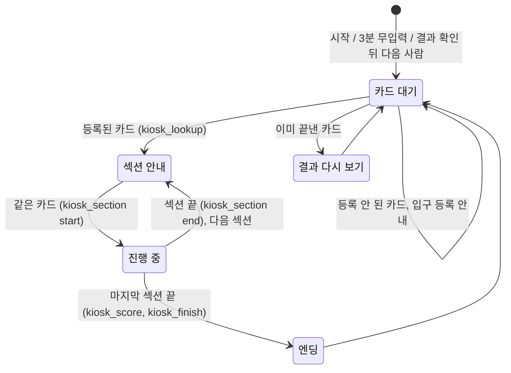
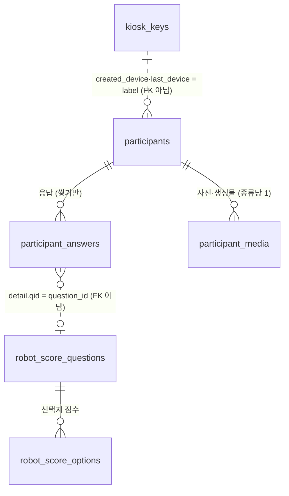

# NFC 사원증 체험 데이터·처리 설계 (v1.0, 현재 구현 기준)

- 관련 이슈: #19 (설계), #37 (카드별 체험자), #45 (입구 등록 → 카드 → 키오스크)
- 작성: 2026-11-10 초안 v0.11 → **2026-11-25 v1.0으로 다시 씀**
- 상태: dev·main에 반영된 코드(PR #49·#50)를 기준으로 씁니다. 코드와 이 문서가 다르면 코드가 맞고, 이 문서를 고칩니다.
- 근거 코드: `supabase/migrations/*.sql`, `app/participants.js`, `app/card-reader.js`, `app/index.html`(`MODE`, `flow*` 함수)

v0.11은 "중앙 PC 1대에 Node.js 서버 + SQLite, 전시장 LAN"을 전제로 한 설계였습니다. 실제 구현은 **Supabase(클라우드 Postgres) + 정적 웹 앱**으로 바뀌었고, 부위별 로봇화·장치 점유·콘텐츠 버전 같은 장치는 만들지 않았습니다. 무엇이 왜 바뀌었는지는 [9절](#9-v011-초안에서-바뀐-점)에 모았습니다. v0.11 원문은 이 문서를 올린 PR의 첫 커밋(`docs: NFC 체험 데이터·처리 설계 초안 추가`)에서 볼 수 있습니다.

---

## 1. 전체 구성

```text
 ┌ 입구 등록 (맥·노트북) ┐      ┌ 면접 키오스크 (라즈베리파이 5) ┐      ┌ 운영자 ┐
 │ /app/?mode=register   │      │ /app/?mode=kiosk                │      │ 관리자설정(PIN) │
 │ 웹캠 촬영 + 리더기     │      │ 리더기 (CH559, 키보드 입력형)    │      │ 또는 SQL Editor │
 └──────────┬────────────┘      └───────────────┬─────────────────┘      └────────┬────────┘
            │ HTTPS  POST /rest/v1/rpc/kiosk_*  (anon 키 + 장치 키)                 │
            └─────────────────────────────┬─────────────────────────────────────────┘
                                          ▼
                         Supabase (팀 프로젝트, Postgres)
                         public.participants · participant_answers · participant_media
                         public.robot_score_* · private.kiosk_keys
```

| 구성 요소 | 역할 | 비고 |
| --- | --- | --- |
| 웹 앱 `app/` | 화면 전부. 빌드 없는 정적 파일 | 운영: Vercel 팀 프로젝트 `main` → `/app/`. 로컬 서버(`python3 -m http.server`)로도 실행 |
| 입구 등록 스테이션 | 직무 선택 → 사진 촬영 → 카드 태그로 체험자 생성 | `/entrance` → `?mode=register`, 장치 역할 `register` |
| 면접 키오스크 | 섹션마다 카드를 대고 설문·과제 진행, 엔딩에서 결과 | `/kiosk` → `?mode=kiosk`, 장치 역할 `kiosk`. 지금은 1대가 세 섹션 전부 |
| 운영자 | 이름 입력, 단계 이동, 목록·삭제, 점수표 수정 | 앱의 관리자설정, Supabase 대시보드 |
| NFC 리더기 | 카드 UID를 키보드처럼 입력(10자리 숫자 + Enter) | `app/card-reader.js`가 가로채 `cardtag` 이벤트로 바꿈 |
| Supabase | 모든 저장과 판단(장치 키 확인, 카드 연결, 점수 계산) | 테이블은 RLS로 막고 `kiosk_*` 함수로만 접근 |

`?mode`를 붙이지 않으면 예전처럼 한 화면에서 전체 흐름(홈 → 직무 → 촬영 → 세 섹션 → 엔딩)을 진행합니다. 이때는 카드를 대면 `kiosk_tag`로 체험자를 불러오거나 새로 만듭니다(#37 방식).

---

## 2. 체험 흐름

### 2.1 입구 등록 (`?mode=register`)

1. 홈 → 면접대기실 대화 → 직무 선택 → 사진 촬영. 대기실 대화 답변은 체험자가 생기기 전이라 브라우저에 모아 둡니다.
2. 촬영 확인 후 "받은 카드를 리더기에 대 주세요" 안내.
3. 카드를 대면 사진을 저장용으로 줄인 뒤(`shrinkPhoto`: 가로 최대 1920px JPEG, 품질 0.92) `kiosk_register(uid, job, photo)`를 한 번 부릅니다. 체험자 생성, 카드 연결, 사진 저장이 한 트랜잭션입니다.
4. 모아 둔 대기실 답변을 `section = 'lobby'`로 저장합니다.
5. "NO18 등록 완료! 면접 키오스크로 이동해 주세요"를 띄우고 6초 뒤 홈으로 돌아갑니다. 운영자가 관리자설정을 열어 이름을 입력하는 중이면 닫을 때까지 기다립니다.

**카드 재사용:** 이미 다른 체험자에게 연결된 카드로 등록하면, 이전 체험자에게서 카드만 떼어 냅니다(`card_uid = null`, `profile.prev_card_uid`·`card_released_at` 기록). 이전 체험자의 응답·결과는 지우지 않습니다. 안내에 "이전 NO17의 카드를 다시 씀"이 함께 뜹니다.

**리더기·카드가 하나뿐일 때(중간전시):** 입구 주소에 `&card=<카드 번호>`를 붙이면 촬영 후 확인만 눌러도 그 카드로 등록합니다. 리더기는 키오스크에 두고, 같은 카드를 다음 사람이 이어 씁니다.

### 2.2 면접 키오스크 (`?mode=kiosk`)

섹션 순서는 **01 인성 → 02 직무적합성 → 03 가치관**이고, **섹션을 시작할 때마다 카드를 댑니다**(1대가 세 섹션을 맡으면 세 번).



| 상황 | 처리 |
| --- | --- |
| 처음 대는 카드 | `kiosk_lookup` → 사진(`kiosk_media_get`)·직무·이전 응답을 불러옴 → 아직 끝내지 않은 첫 섹션으로 이동 |
| 지금 체험자의 카드, 섹션 안내 화면 | 그 섹션 시작 기록 후 질문·과제 시작 |
| 지금 체험자의 카드, 진행 중 | 무시(리더기 연속 읽기) |
| 다른 사람 카드, 진행 중 | "다른 분의 카드예요. NO18님의 면접이 진행 중이에요" 안내만, 진행 그대로 |
| 등록되지 않은 카드 | 오류 `P0002` → "입구에서 사진 촬영과 카드 등록을 먼저 해 주세요" |
| 설문을 끝낸 카드 | 저장된 응답으로 엔딩을 다시 보여 줌(결과를 새로 저장하지 않음) |
| 3분 동안 입력 없음 | 카드 대기 화면으로(진행 기록은 남아 있어 다시 대면 이어 함) |

이어 하기: 다른 키오스크나 다시 켠 화면에서도 `kiosk_lookup` 결과의 `progress`와 `answers`로 끝낸 섹션을 건너뛰고, 가치관 최종 답에 따른 꼬리 질문 갈래까지 되살립니다.

### 2.3 엔딩과 결과 저장

마지막 섹션이 끝나면 `kiosk_score`로 로봇화 %를 받고(5절), 엔딩 화면과 저장이 같은 값을 씁니다. 저장은 `kiosk_finish(result)`이며 `finished_at`을 남기고 단계를 '면접 완료'로 바꿉니다. 다시 부르면 새 값으로 덮어씁니다(운영자가 되돌려 다시 진행한 경우).

```jsonc
// participants.result
{
  "robot_percent": 62,               // 엔딩의 로봇화 %
  "score_source": "db",              // db: kiosk_score / local: 브라우저 계산(대신 쓴 경우)
  "robot_score": { "weight_total": 6.5, "parts": [ /* 문항별 가중치·점수 */ ] },   // local이면 null
  "fit_percent": 70,                 // 꼬리 질문 문구의 "자사에 n% 적합" (브라우저 계산)
  "tag": "호기심", "title": "…",     // 인성 답에서 고른 개성 태그와 직함
  "task": { "job": "design", "ok": 2, "total": 3, "passed": true }   // 직무 과제(임시 기준: 절반 이상 성공)
}
```

---

## 3. 데이터 설계

### 3.1 ERD



### 3.2 테이블

**`public.participants`** — 체험자 1명 (마이그레이션 `20261124120000`, `20261125120000`, `20261125130000`)

| 컬럼 | 형식 | 설명 |
| --- | --- | --- |
| id | uuid PK | |
| card_uid | text, UQ, 비울 수 있음 | 정규화한 UID(`^[0-9A-F]{4,32}$`). 카드를 다른 사람에게 넘기면 `null` |
| no | integer, UQ | 면접자 번호. 시퀀스 `participant_no_seq`, NO17부터 |
| name | text ≤ 40 | 관리자가 입력(없어도 됨) |
| job | text ≤ 40 | `dev`, `design`, `hr`, `marketing`, `biz` |
| stage | text | '등록 완료' → '인성'·'직무적합성'·'가치관' → '면접 완료' (표시용) |
| profile | jsonb 객체 | 추가 정보. 카드 재사용 기록(`prev_card_uid`, `card_released_at`) |
| progress | jsonb 객체 | 섹션별 `{started_at, finished_at, device}`. 키 `person`·`fit`·`values` |
| registered_at | timestamptz | 입구에서 등록한 시각. **비어 있으면 `kiosk_lookup`이 찾지 않음**(예전 `kiosk_tag`가 자동으로 만든 체험자) |
| finished_at | timestamptz | 설문을 끝낸 시각 |
| result | jsonb 객체 ≤ 20KB | 2.3절 결과 요약 |
| created_device, last_device | text | 장치 키의 `label` |
| created_at, updated_at, last_seen_at | timestamptz | 모두 서버 시각(`now()`) |

**`public.participant_answers`** — 응답 기록. 고치지 않고 쌓기만 합니다. 같은 문항에 다시 답하면 새 행이 생기고 **가장 최근 것이 유효**합니다.

| 컬럼 | 형식 | 설명 |
| --- | --- | --- |
| id | bigint PK (identity) | 순서의 기준 |
| participant_id | uuid FK → participants (cascade) | |
| section | text | `lobby`, `person`, `fit`, `values` |
| detail | jsonb | 앱의 `answer` 이벤트 그대로. 문항: `{section, question, qid, choice, robot, q, answer}`, 직무 과제: `{choice: {type, …과제 결과}}`, 시간 초과는 `choice: null` |
| device | text | 장치 키 `label` |
| answered_at | timestamptz | 서버 시각 |

**`public.participant_media`** — 사진·생성물. 체험자 1명 × 종류 1개(PK `(participant_id, kind)`).

| 컬럼 | 형식 | 설명 |
| --- | --- | --- |
| kind | text | `photo`(입구 촬영), `toy_2d`·`model_3d`(#23 생성물, 지금은 자리만) |
| status | text | `pending`, `ready`, `failed` |
| data | text ≤ 300만 자 | 이미지 data URL(`jpeg`·`png`·`webp`). 사진은 여기에 바로 넣음 |
| storage_path | text | 큰 생성물(3D 모델 등)은 Storage나 중앙 PC에 두고 경로만 |
| meta, error | jsonb, text | 생성 정보, 실패 이유 |

**`public.robot_score_questions` / `robot_score_options`** — 로봇화 점수표(5절). 점수·가중치는 팀 확정 전 임시값이고, 대시보드에서 `weight`·`score`만 고치면 됩니다.

**`private.kiosk_keys`** — 장치 키. 키 원문은 저장하지 않고 sha256만 둡니다.

| 컬럼 | 설명 |
| --- | --- |
| key_hash | 키의 sha256 (PK) |
| label | 장치 이름(UQ). 예: `entrance-1`, `kiosk-1`, `admin-1` |
| role | `legacy`(#45 전 키), `register`, `kiosk`, `admin` |

`private` 스키마는 API로 노출되지 않습니다.

### 3.3 함수 (anon이 부르는 API)

모든 함수는 첫 인자로 장치 키(`p_key`)를 받고, 키와 역할을 먼저 확인합니다. 앱은 `app/participants.js`의 `Participants.*`로 부릅니다.

| 함수 | 하는 일 | 허용 역할 | 앱 |
| --- | --- | --- | --- |
| `kiosk_register(uid, job, photo?, name?, profile?)` | 체험자 생성 + 카드 연결(재사용이면 이전 연결 해제) + 사진 | register, admin | `register` |
| `kiosk_lookup(uid)` | 카드로 체험자 + 응답 + 사진 목록 + `finished`. 만들지 않음 | kiosk, admin | `lookup` |
| `kiosk_media_get(id, kind)` | 사진·생성물 1개 | register, kiosk, admin | `media` |
| `kiosk_section(id, section, 'start'·'end')` | 섹션 시작·끝 기록. 시작 시각은 처음 값 유지 | kiosk, admin | `section` |
| `kiosk_score(id)` | 로봇화 점수 계산(읽기만) | kiosk, admin | `score` |
| `kiosk_finish(id, result)` | 완료 시각·결과 저장 | kiosk, admin | `finish` |
| `kiosk_answer(id, section, detail)` | 응답 1건 추가 | 모든 역할 | `answer` |
| `kiosk_update(id, patch)` | 이름·직무·단계·profile 수정 | 모든 역할 | `update` |
| `kiosk_tag(uid)` | 카드로 찾고, 없으면 **새로 만듦**(#37) | 모든 역할 | `tag` (`?mode` 없을 때) |
| `kiosk_list()`, `kiosk_delete(id)` | 관리자 목록·삭제 | 모든 역할 | `list`, `remove` |

아래 다섯 개(`kiosk_answer`~`kiosk_delete`)는 #37 때 만든 함수입니다. 배포 사이트가 같은 DB를 쓰고 있어 동작을 바꾸지 않았고, 그래서 역할을 확인하지 않습니다(키만 확인). 권한 제한과 자동 등록 제거는 후속 작업입니다(10절).

오류 코드는 서버와 로컬 모드가 같습니다: `28000` 장치 키가 틀림, `42501` 역할이 맞지 않음, `22023` 입력값 오류, `23514` 사진 형식 오류(`data:image/…;base64`만, 300만 자 이하), `P0002` 없음(등록 안 된 카드 포함).

---

## 4. 카드와 리더기

- 리더기는 USB 키보드처럼 동작하는 CH559 리더(10자리 십진수 UID + Enter)입니다. 드라이버나 별도 리더 프로그램 없이 브라우저가 받습니다.
- `app/card-reader.js`가 키 입력을 가장 먼저 받아, 80ms 간격 안으로 8자리 이상 숫자가 이어지고 Enter가 오면 카드 태그로 봅니다. 사람이 친 숫자는 그대로 앱에 넘기므로 답 선택·PIN과 섞이지 않습니다.
- UID는 서버에서 공백·기호를 빼고 대문자로 정규화합니다(`private.normalize_uid`). 리더기마다 표기가 달라도 같은 카드로 봅니다.
- UID는 복제할 수 있는 값이라 비밀번호처럼 쓰지 않습니다. 전시장 안에서 사람을 구분하는 용도로만 씁니다.
- 브라우저 창이 포커스를 잃으면 태그를 못 받습니다. 키오스크는 Chromium 전체 화면으로 띄웁니다.
- 개발 중에는 콘솔에서 `CardReader.simulate('0000790572')`로 태그를 흉내 냅니다.

---

## 5. 로봇화 점수

`private.robot_score(id)`가 저장된 응답으로 계산하고, `kiosk_score`가 이를 돌려줍니다(`20261125140000_robot_score.sql`, `20261125150000_robot_score_legacy_qid.sql`).

```text
로봇화 % = Σ(가중치 × 고른 선택지 점수) ÷ Σ(답한 문항의 가중치)   → 반올림한 정수
```

- 선택지 점수는 0~100이고, 회사에 순응할수록 100입니다.
- 같은 문항에 여러 번 답했으면 가장 최근 응답만 씁니다.
- 시간 초과로 답하지 않은 문항(`choice: null`)은 분자·분모에서 모두 뺍니다.
- 직무 과제(`fit-task`)는 성공한 과제 수 ÷ 전체 과제 수 × 100입니다. 디자인은 `rounds[].pass`, 개발은 `home/total`, 인사는 `weeksOk/total`, 마케팅·경영은 `success/total`을 씁니다.
- 꼬리 질문은 가장 최근 최종 질문 답의 갈래(A → `values-tail-1`, B → `-2`, C → `-3`)만 셉니다.
- 점수표에 없는 문항(인성, 대기실 대화)은 계산에 넣지 않습니다. 인성은 개성 태그에만 씁니다.
- 가치관 문항이 하나도 계산되지 않으면 `robot_percent`는 `null`입니다.
- 문항은 응답의 `qid`(앱 `QUESTIONS`의 `id`)로 찾습니다. `qid`가 없는 예전 응답은 가치관 문항 순서(`question` 0~4)로 대신 찾습니다.

| question_id | 내용 | 가중치(임시) |
| --- | --- | --- |
| `values-1` ~ `values-3` | 초과 근무, 친목·동아리 필참, 근속 계약 | 1 |
| `values-final` | 자사가 귀하를 채용해야 할 이유 | 0.5 |
| `values-tail-1` ~ `-3` | 최종 답에 따른 꼬리 질문 | 2 |
| `fit-task` | 직무 과제 성공 비율 | 1 |

**규칙**

- 점수표를 고치면 다음 계산부터 새 기준이 적용됩니다. 이미 끝낸 체험자도 다시 계산하면 새 기준으로 나옵니다. 다만 `participants.result`에 저장된 값은 그대로이므로, 엔딩에서 본 값과 다를 수 있습니다.
- 앱 `QUESTIONS`의 `id`를 바꾸면 점수표의 `question_id`도 같이 바꿔야 합니다.
- **대신 계산:** 장치 키가 없거나(로컬 모드), DB가 오류를 내거나, 9초 안에 답이 없거나, `robot_percent`가 `null`이면 브라우저의 예전 계산(`robotPercent()`, 문항별 ±1)을 씁니다. 이때 `result.score_source = 'local'`입니다.
- 점수를 부르기 전에 아직 못 보낸 응답이 있으면 최대 5초 기다려 먼저 보냅니다(6절).

---

## 6. 네트워크가 끊길 때와 로컬 모드

| 요청 | 실패하면 |
| --- | --- |
| `answer`, `update`, `section`, `finish` (저장) | 브라우저의 보낼 목록(`pass-outbox`)에 쌓아 순서대로 다시 보냄. 네트워크·5xx 오류는 5초 뒤 재시도, 새로고침해도 이어서 보냄. 4xx(삭제된 체험자 등)는 버림. 단 장치 키 오류(`28000`)는 버리지 않고 기다림 |
| `register`, `lookup` (카드 태그) | 안내를 띄우고 끝. 관객이 카드를 다시 대면 됨 |
| `score` | 브라우저 계산으로 대신함(5절) |
| 모든 호출 | 8초 안에 답이 없으면 실패로 봄 |

- **로컬 모드:** `app/config.js`의 Supabase 값이나 장치 키가 없으면 같은 함수들이 그 브라우저의 localStorage(`pass-local-participants`, 사진은 `pass-local-media:<id>:<kind>`)에서 같은 모양으로 동작합니다. 같은 브라우저의 탭끼리만 공유되므로 개발·시연용입니다.
- **장치 키 보관:** 처음 주소에 `?kiosk=<키>`를 붙여 열면 브라우저가 기억하고 주소창에서 지웁니다. 입구(`?mode=register`)는 키와 보낼 목록을 따로 보관(`pass-kiosk-key:register`, `pass-outbox:register`)하므로, 한 브라우저에 입구와 키오스크 탭을 함께 열어도 서로 덮어쓰지 않습니다.
- **인터넷이 오래 끊기면:** 새 카드 등록과 조회가 안 됩니다. 이미 진행 중인 체험자의 응답은 보낼 목록에 쌓였다가 연결되면 들어갑니다. 전시장 인터넷이 불안하면 v0.11의 중앙 PC 로컬 서버안을 다시 검토합니다(10절).

---

## 7. 보안과 개인정보

**보안**

- 브라우저에는 공개돼도 되는 anon 키만 있습니다. 테이블은 RLS를 켜고 정책을 두지 않아 anon이 직접 읽거나 쓸 수 없습니다.
- 모든 접근은 `security definer` 함수를 거치고, 함수가 장치 키와 역할을 먼저 확인합니다. `npx supabase db advisors --remote`의 "anon이 실행할 수 있는 SECURITY DEFINER 함수" 경고는 이 구조 때문이며 의도한 것입니다.
- 장치 키는 저장소에 넣지 않습니다. 장치마다 `select private.new_device_key('kiosk-2', 'kiosk');`로 만들고, 결과는 그때 한 번만 보입니다.

**개인정보**

| 정보 | 어디에 | 지금 정한 것 |
| --- | --- | --- |
| 얼굴 사진 | `participant_media.data` (Supabase) | 입구 촬영 사진을 DB에 저장합니다. 키오스크 배지와 #23 토이 생성에 쓰기 위해서입니다(v0.11의 "사진은 서버에 두지 않음"에서 바뀜) |
| 이름 | `participants.name` | 관리자가 입력합니다. 없어도 진행됩니다 |
| 응답·결과 | `participant_answers`, `participants.result` | 전시장 안에서 결과 다시 보기에 씁니다 |
| 카드 UID | `participants.card_uid` | 개인을 직접 가리키지 않는 카드 번호입니다 |

- **아직 정하지 않은 것:** 촬영 동의 안내 문구, 사진·이름·응답을 지우는 시점과 절차(전시 종료 후 일괄 삭제가 기본안), 중간전시·관객 테스트에서 찍은 사진의 처리. 실제 관객 사진을 받기 전에 정해야 합니다(10절).
- 지울 때는 `delete from public.participants where …`만으로 응답·사진이 함께 지워집니다(cascade). 번호 시퀀스는 따로 되돌립니다.
- 이 문서는 법률 검토가 아닙니다. 학교나 전시 측 기준이 있으면 그에 맞춥니다.

---

## 8. 검증

| 범위 | 방법 | 결과 (2026-11-25) |
| --- | --- | --- |
| DB 함수 (로컬) | `cd supabase/tests && npm install && npm test`. 마이그레이션을 빈 PGlite(Docker 불필요)에 적용하고 `*.test.sql`을 실행 | 등록·조회·재사용·섹션 진행·점수 계산(예전 응답 포함) 모두 통과 |
| DB 함수 (팀 프로젝트) | `npx supabase db query --remote --yes -f supabase/tests/register_kiosk_flow.test.sql` 등. 시험은 rollback하므로 데이터가 남지 않음 | 통과. 오류가 없으면 통과(notice는 보이지 않음) |
| 앱 흐름 (로컬 모드) | 장치 키 없이 브라우저에서 입구 → 키오스크 → 엔딩 | 확인 |
| 운영 배포 | `/app/`, `/app/?mode=kiosk` 열기 | 정상(콘솔 404는 저장소에 없는 넥슨 폰트뿐) |
| **안 한 것** | 실제 장치 키로 원격 DB 왕복, 라즈베리파이 + CH559 실기, 다른 사람 카드로 끼어들기, 장시간 운영 | 중간전시 전에 확인 |

---

## 9. v0.11 초안에서 바뀐 점

| 항목 | v0.11 초안 (11/10) | 지금 구현 | 바뀐 이유 |
| --- | --- | --- | --- |
| 서버·DB | 중앙 PC 1대에 Node.js + SQLite, 전시장 유선 LAN, HTTP + WebSocket | Supabase(클라우드 Postgres) + RPC 함수. 앱은 정적 파일(Vercel) | 서버 프로그램 없이 빨리 만들고, 팀 계정 하나로 운영하려고. 대신 인터넷에 의존함(6절) |
| 리더기 | PC/SC 리더 + 리더 프로그램 권장 | 키보드 입력형 CH559, 브라우저 `card-reader.js` | 실제로 받은 리더기가 HID 방식. 리더 프로그램 설치·자동 시작이 필요 없음 |
| 장치 | `devices` 테이블, 역할 `issue/booth/result/central/admin` | `private.kiosk_keys`(라벨·역할·키 해시), 역할 `register/kiosk/admin` | 장치 확인을 키 하나로 해결. 결과·중앙 장치는 아직 없음 |
| 카드·체험 | `cards` + `experiences`(카드 1 : 체험 N), 재발급 시 운영자 확인 | `participants.card_uid`(UQ). 입구에서 다시 등록하면 이전 체험자에서 카드만 떼어 냄 | 카드를 계속 돌려 쓰는 운영(중간전시 카드 1장)에 맞춤 |
| 방문 순서 | 부스 3개(섹션 1개 = 부스 1개)를 자유 순서로 | 지금은 키오스크 1대가 인성 → 직무 → 가치관 순서. 섹션마다 카드 | 장비 1대로 먼저 운영. 최종 전시 1대 1섹션은 `progress`로 준비만 함 |
| 검사 기록 | `booth_attempts` + 완료 버튼에서 응답을 한 트랜잭션으로 제출 | 문항마다 `kiosk_answer`로 바로 쌓고 최근 것이 유효. 섹션 시작·끝은 `progress` | 구현이 단순하고, 중간에 끊겨도 답한 데까지 남음. 대신 "제출 완료" 단위의 원자성은 없음 |
| 장치 점유 | `device_leases`(90초 임대, heartbeat, 장치 이동) | 없음. 키오스크 화면이 진행 중 다른 카드를 거절 | 1대 1명 운영이라 서버 점유가 필요 없었음. 1대 1섹션으로 바꿀 때 다시 검토 |
| 콘텐츠 버전 | 버전별 JSON(`experience_versions`), 체험 시작 때 고정, 에셋 해시 고정 | 문항은 `index.html`, 점수표는 DB 테이블. 버전 고정 없음 | 전시 중 문항이 거의 바뀌지 않음. 점수표를 고치면 다시 계산할 때 새 기준이 됨(5절) |
| 로봇화 계산 | 부위 5개(`torso`·팔·다리)별 0~100, `part-sum-v1`, `result_parts` | 전체 로봇화 % 하나(가중 평균), 엔딩에서 n%만큼 스캔 연출 | 엔딩 연출이 전체 비율 하나를 씀. 점수표는 팀이 표로 다루기 쉬움 |
| 결과 | `results`(불변, 입력 지문, 무효화) | `participants.result` 한 칸. 다시 끝내면 덮어씀 | 결과 장치와 운영자 초기화 흐름이 아직 없음 |
| 결과 다시 보기 | 결과 장치(2D) + 중앙 공간(3D 아바타) | 끝낸 카드를 키오스크에 다시 대면 엔딩을 다시 보여 줌 | 중앙 3D PC는 아직 준비 중 |
| 사진 | 발급 노트북 메모리에만. 서버·DB로 보내지 않음 | `participant_media`에 저장 | 키오스크마다 같은 얼굴 배지를 보여 주고, #23 토이(2D·3D) 생성에 원본이 필요해서 |
| 아바타 | 얼굴 특징값 11개(`avatar_json`), 전시 후 삭제 | 없음. `toy_2d`·`model_3d` 자리만 | 사진 → 토이 이미지 → 3D 생성 방식(#23)으로 방향을 바꿈 |
| 초기화 | `resets` 테이블(범위·주체·사유), 무효화 | 관리자설정에서 단계 이동·삭제. 별도 기록 없음 | 운영 규모가 작아 먼저 생략 |
| 서버 불통 | 멈추고 재시도, 부스 임시 저장 없음 | 저장 요청은 브라우저에 쌓았다가 재전송 | 클라우드 DB라 잠깐 끊기는 경우가 더 흔함. 응답을 잃지 않는 쪽을 택함 |

**v0.11에서 그대로 가져온 원칙**

- 카드에는 아무것도 쓰지 않고 UID만 읽습니다.
- 시각은 모두 서버(`now()`)가 기록합니다. 파이 시계는 믿지 않습니다.
- 응답은 고치지 않고 쌓습니다. 다시 하면 새 기록이 생깁니다.
- 판단(장치 확인, 카드 연결, 점수)은 서버가 하고, 화면은 결과를 보여 줍니다.

---

## 10. 남은 일과 결정할 것

| 항목 | 내용 | 관련 |
| --- | --- | --- |
| 점수표 확정 | 선택지 점수·가중치는 임시값. 팀이 정하면 대시보드에서 수정 | 5절 |
| 실기 시험 | 실제 장치 키 + 라즈베리파이 + CH559로 입구 → 키오스크 → 엔딩, 다른 카드 끼어들기, 3분 무입력 | 8절 |
| 개인정보 | 촬영 동의 안내, 사진·이름·응답 삭제 시점과 절차, 테스트 사진 처리 | 7절 |
| 예전 함수 정리 | `kiosk_tag`(자동 등록)와 #37 함수 5개의 역할 확인. 배포 사이트를 새 흐름으로 완전히 옮길 때 | 3.3절 |
| 키오스크 1대 = 1섹션 | 최종 전시 구성. 키오스크마다 맡을 섹션 지정, 순서가 바뀌어도 되는지, 동시 사용 시 점유가 필요한지 | 2.2절, 9절 |
| 관리자 페이지 | 이름 입력·목록을 앱 밖의 `admin.html`로 분리할지 | — |
| 토이·3D 생성 | `participant_media`의 `toy_2d`·`model_3d`를 채우는 생성 프로그램과 저장 위치 | #23 |
| 중앙 3D 결과 | 중앙 PC에서 카드로 결과·3D 모델 보기 | — |
| 인터넷 없는 전시장 대비 | 전시장 네트워크 확인. 불안하면 로컬 서버안 재검토 또는 휴대폰 핫스팟 예비 | 6절 |
| 외부 CDN | three.js·폰트를 CDN에서 받음. 오프라인 운영이 필요하면 로컬로 | `app/README.md` |
